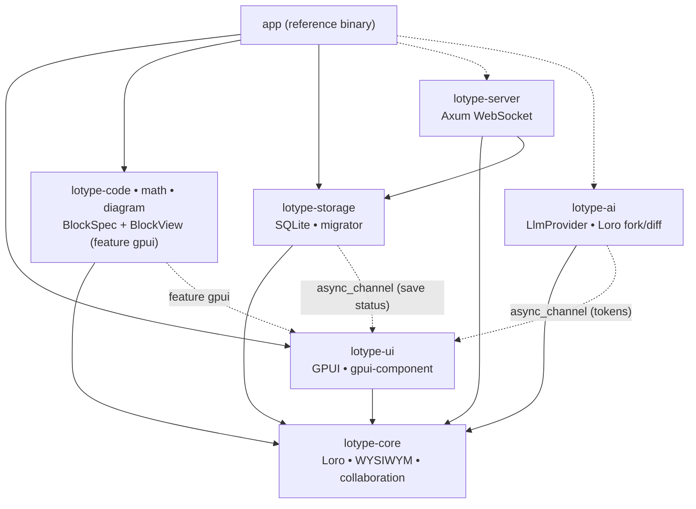

# Lotype Architecture

Lotype is a native Rust SDK for block-based document editors. It has two layers:

- **`lotype-core`**: a headless WYSIWYM engine with realtime collaboration, built on [Loro](https://github.com/loro-dev/loro). JS equivalent: ProseMirror + Yjs.
- **`lotype-ui`**: a WYSIWYG editor built on GPUI. JS equivalent: Tiptap + BlockNote + React.

Unlike the JS stack, these are two layers with a clear boundary, not three layers patching each other. There is no browser DOM and no WebView.

Status: **alpha**. License: **MIT OR Apache-2.0**.

**Name and identity.** The name comes from the *line-o'-type* machine, which cast a whole line of text as one solid metal slug, just as Lotype treats a document as blocks.

| | |
| :--- | :--- |
| Website | [lotype.dev](https://lotype.dev) |
| Docs | [docs.lotype.dev](https://docs.lotype.dev) |
| Document schema namespace | `https://lotype.dev/schema/v1` |
| Source | [github.com/lotype/lotype](https://github.com/lotype/lotype) |

---

## 1. Scope

| | |
| :--- | :--- |
| **Product** | An SDK published as crates on crates.io. The in-house editor is the first consumer. |
| **First-release consumers** | Rust/GPUI applications on macOS |
| **First-release platform** | macOS only: Intel (`x86_64`) and Apple Silicon (`aarch64`), shipped as a universal binary |
| **First-release features** | Realtime collaboration, cross-block text selection, nested blocks, tables (no merged cells), AI (selection prompt + multi-turn chat panel) |
| **Out of scope** | Windows, Linux, iOS, Swift consumers, video and audio blocks |

### 1.1 Why native

1. **WebView fragmentation.** `prosemirror-view` 1.43 has 60 browser-specific branches in 6,530 lines and 87 references to IME composition. They are concentrated in input, selection and keyboard handling. Under Tauri, the WebView version follows the OS, so it cannot be pinned.
2. **Layers patching each other.** In BlockNote 0.57 on top of Tiptap/ProseMirror:
   - one block is three ProseMirror nodes (`blockGroup` → `blockContainer` → `blockContent`);
   - block IDs are re-applied after every transaction via `appendTransaction`;
   - five helpers translate between positions and blocks;
   - menu logic in BlockNote's core package is coupled to the DOM.

Going native does not remove per-OS work. It moves that work to the OS text-input APIs (`NSTextInputClient` on macOS). Targeting only macOS in the first release keeps this to a single platform.

### 1.2 Future direction (not built in the first release)

The long-term goal is native macOS and iOS apps, including rich-text chat UIs. This is an unvalidated hypothesis, and the first-release architecture must not rule it out.

- **iOS.** `gpui-pre-ios` (Zed's `gpui_ios`) exists but is young: about 3.6k lines, against about 10k for the macOS backend.
- **Swift apps.** A future `lotype-ffi` crate (UniFFI) plus a native TextKit 2 editor, reusing `core`. `loro-swift` shows this pattern works.
- **Chat.** A restricted "chat" schema profile via the `BlockSpec` registry, using Markdown as the interchange format.

What keeps these doors open: `core` has no GPUI or OS dependencies, and the schema is extensible.

### 1.3 Migration from the legacy stack (Tauri + React + Tiptap/BlockNote)

| Legacy component | Decision | Target |
| :--- | :--- | :--- |
| ProseMirror model/state/transform | Replace | `lotype-core`: a Loro block tree with native IDs. `Pos { block, offset }` replaces integer positions. |
| `prosemirror-history` | Drop | `loro::UndoManager`, local-only, like `Y.UndoManager` |
| Yjs / y-prosemirror | Replace | `loro`: relative positions become `loro::Cursor`; awareness becomes `EphemeralStore` |
| Tiptap extensions + BlockNote specs | Merge | `BlockSpec` / `InlineSpec` / `MarkSpec` in core, `BlockView` in ui |
| React UI and editor view | Rewrite | `lotype-ui` (GPUI + `gpui-component`) |
| Legacy JSON documents | Port the schema; add a migrator | One-way `JSON (Tiptap/BlockNote) → Loro` in `lotype-storage`; `callout` becomes `alert` |
| Axum HTTP/SSE server | Repurpose | `lotype-server`: a WebSocket sync library the consumer mounts |
| Tauri IPC and WebView config | Retire | Remove all `#[tauri::command]` handlers, the JSON IPC and the WebView workarounds |
| Tokio LLM client logic | Port behind a trait | An `LlmProvider` implementation; keep the prompt builder and stream parser; output goes to `async_channel` |
| `@blocknote/xl-ai` | Design reference only | GPL-3.0 OR PROPRIETARY: no code is ported |

---

## 2. Crates

| Crate | Role | Depends on |
| :--- | :--- | :--- |
| `lotype` | Umbrella crate; re-exports behind feature flags | all |
| `lotype-core` | Block tree, schema, commands, selection, local undo, sync updates, awareness, Markdown | `loro`, `pulldown-cmark` |
| `lotype-ui` | GPUI editor and built-in blocks | `core`, `gpui-component` |
| `lotype-code` | Syntax highlighting for code blocks | `core`, `ui` (feature `gpui`) |
| `lotype-math` | LaTeX blocks and inline math | `core`, `katex-rs`, `katex-native`, `ui` (feature `gpui`) |
| `lotype-diagram` | Mermaid diagram blocks | `core`, `bezel-mermaid`, `ui` (feature `gpui`) |
| `lotype-server` | WebSocket sync as an embeddable Axum router; self-hosted by the consumer | `core`, `storage`, `axum` |
| `lotype-storage` | SQLite snapshots, debounced auto-save, migrator for legacy Tiptap/BlockNote JSON | `core`, `tokio` |
| `lotype-ai` | Selection prompt, multi-turn chat, LLM provider trait | `core`, `tokio` |
| `app` (binary) | Reference application that wires Tokio and GPUI together | all |

All dependencies point towards `core`. `core` never depends on GPUI, Tokio or any OS API.



---

## 3. Core / UI boundary

**Rule:** if it can be tested without a window, it belongs in `lotype-core`. If it needs pixels, the OS or GPUI events, it belongs in `lotype-ui`.

| `lotype-core` (no pixels, synchronous) | `lotype-ui` (GPUI) |
| :--- | :--- |
| Block tree (`LoroTree`) with inline content (`LoroText`) and marks | Block rendering, text layout (`TextRun` from marks), virtual list |
| Schema registry: `BlockSpec`, `InlineSpec`, `MarkSpec` | `BlockView` per block type |
| Commands: insert, update, move, split, merge, toggle mark | Hit-testing between pixels and `Pos`; drawing the cursor and selection |
| `Selection::{Text, Blocks, Cells}` | IME via `EntityInputHandler`, converting UTF-16 ↔ UTF-8 |
| Local undo/redo | GPUI actions → core commands (the keymap comes from core) |
| Input rules and paste rules | Slash menu, formatting toolbar and link toolbar views |
| Keymap as data | Side menu, drag handle, hover, drop, block geometry |
| Slash menu items, filtering and query state | System clipboard (core does the serialization) |
| Formatting state queries (active marks, block type) | Collaborator cursors (rendered from awareness) |
| Markdown in/out, clipboard serialization | |
| Sync: export/import updates as bytes; `EphemeralStore` | |

A custom block is a `BlockSpec` in core plus a `BlockView` in ui.

---

## 4. Document model (`lotype-core`)

Built on `loro` 1.18. The APIs below were checked in the crate source:

| Need | Loro API |
| :--- | :--- |
| Block tree with IDs and moves | `LoroTree::create_at`, `mov`, `mov_to`, `mov_after`, `mov_before`, `enable_fractional_index` |
| Rich text and marks | `LoroText::mark`, `to_delta`, `apply_delta`, `slice_delta` |
| Mark behaviour at range edges | `configTextStyle` with `expand: before / after / none / both` |
| UTF-8 / UTF-16 offsets | `insert_utf8`, `insert_utf16`, `delete_utf16`, `len_utf8`, `len_utf16`, `convert_pos` |
| Positions that survive remote edits | `get_cursor(pos, side)` → `Cursor` |
| Local undo | `UndoManager` (`set_merge_interval`, `add_exclude_origin_prefix`) |
| Movable lists | `LoroMovableList::mov` |
| Presence | `EphemeralStore` |

Design decisions:

- **Blocks** are `LoroTree` nodes, so every block has a native ID (`TreeID`) with no patching. A block's metadata map holds its type (`$type`), its text (`$text`, a `LoroText` created with the block so two peers never create it separately) and its attributes. Attribute keys starting with `$` are reserved.
- **Block IDs survive undo and redo.** Loro restores a removed block, with its text, marks and children, as a new node under a new `TreeID`. So a block's identity is data in the document, as in Tiptap's and BlockNote's UniqueID extension: each block stores the `TreeID` it was created with in `$id`, and `BlockId` is that value. A `BlockId` prints and parses as text, so an application can keep references to blocks outside the document. After undo or redo, and when an `Editor` takes a document, the core looks up which nodes carry the ID of a removed node. `$id` is shared data that a peer can set to anything, so a block only gets the ID of a node that Loro reports as removed, and only when no other block claims the same ID. A forged `$id` can therefore cost a restored block its old ID, but never gives a block the ID of another block in the document. An import runs the same lookup. So do local edits that can change which ID claims are eligible, including moves across the depth cap. A batch removal checks claims once after removing the selected nodes.
- **Positions** are `Pos { block: BlockId, offset: usize }`. Offsets are UTF-8 bytes and must fall on character boundaries; anything else is rejected. Conversion to UTF-16 happens only at the IME boundary in `lotype-ui`. Inside the editor, the selection and the selections stored with undo steps are also anchored with `loro::Cursor`, so they follow their text through changes from other peers. Undo steps use the exact byte offset until a remote edit changes the anchored text. A range keeps both endpoint anchors across imports. When a peer replaces the selected text, the selection covers the replacement even if the deletion and insertion arrive separately. Selection anchors follow the original tree node across changes to its public `BlockId`.
- **Sync.** `Document::export_snapshot` gives the whole document, `Document::export_updates(&Version)` what a peer at that version lacks, and `Document::import` or `Editor::import` merges either. How the bytes travel is up to the application. Loro reports unreadable bytes as `Error::InvalidUpdate`. With a shallow history it can apply part of an update before returning that error. Importing from an editor goes through `Editor::import` outside any local edit. Remote changes stay out of undo history. One that touches the text being typed ends the current typing step, because Loro ends its undo group there.
- **Untrusted content.** Everything read from the Loro document may come from another peer, possibly one with a different schema, so the core never panics on it and never loses it:
  - Blocks of an unknown type are reported as such and skipped by range commands.
  - Marks outside the schema stay readable. Split, merge and range delete copy text and attributes as stored, so unknown marks and values survive.
  - Tree walks use an explicit stack, never recursion.
- **Nesting is capped at `MAX_DEPTH` (128 levels).** Deeper blocks sent by another peer stay in the shared data but are not part of the document: no method returns them, and local edits cannot create them. The cap bounds every ancestor walk, which keeps reads linear however deep a peer nests.
- **Undo** is local-only (`loro::UndoManager`). Consecutive typing shares one step until a keystroke starts a word after whitespace. Consecutive Backspace or Delete presses within a block share a step by direction. Changing the selection, toggling a mark or running another command ends the current step. Replacing the document through `Editor::apply` starts a fresh history with the replacement as its baseline. Loro can fail to undo a step that changes from other peers have cut across, and it keeps that step on its stack; `Editor::undo` then returns the error and clears the history, since no older step could be reached any more.
- **An edit is published after validation.** `Editor::apply` runs the callback on a private Loro fork. After the callback succeeds and its selection validates, the editor publishes its operations under the same peer and records one undo step. An error or panic discards the draft and preserves the document, selection, and history. The draft's update and snapshot exports are disabled. Single-keystroke typing and deletion use the live document to avoid a fork.
- **Pending marks.** Toggling a mark on a caret sets the formatting for subsequent typing until the selection changes or another editing command runs. Use `Editor::set_mark` with an explicit value for links and colors. By default the editor uses the marks shared by the neighboring characters and the marks whose expand rules reach the caret. If both sides expand a mark with different values, the preceding value wins. `Editor::active_marks` reports the formatting for the next insertion at a caret or the shared formatting across a text selection.
- **Traversal.** Use `Document::blocks()` for a snapshot in document order. Neighbor and path queries share sibling indexes for the current document state.
- **Characters.** Backspace and Delete remove a whole grapheme cluster, including when the caret is between two scalars in that cluster. With a selection they delete the selection. At a block boundary they use a separate undo step for the structural edit.
- **Tables** use a grid model so concurrent edits merge cleanly:
  ```text
  table block
  ├── rows:  LoroMovableList<RowId>
  ├── cols:  LoroMovableList<ColId>
  └── cells: LoroMap<"row:col" → LoroText>
  ```
  Adding a row and a column concurrently cannot produce rows of different lengths. Merged cells are deferred.
- **Schema normalization.** A concurrent merge can produce a schema violation, such as a heading with children. Such violations are tolerated when rendering and are never written back to the document. If every peer wrote its own fix, the fixes could conflict with each other.
- **IME.** Text that is still being composed (*marked text*) lives in `ui` as a preview. It is committed to core only when composition ends, and its anchor is kept as a `loro::Cursor` in case remote edits arrive meanwhile.
- **Markdown** uses `pulldown-cmark` 0.13.6 with `ENABLE_GFM` and `ENABLE_MATH`.

`loro-prosemirror` is not used as a model reference. It stores nodes in `LoroList` without `LoroTree`, so a block move becomes delete + insert, and concurrent edits to the moved block can be lost.

---

## 5. UI layer (`lotype-ui`)

- **GPUI.** `gpui-component` 0.10.0 depends on `gpui-pre = "=0.3.12"`. This is a GPUI snapshot republished by the gpui-component maintainer, not by the Zed team.
- **Taken from `gpui-component`:** `menu`, `popover`, `virtual_list`, `command`, `toolbar`, `tooltip`, `clipboard`, `highlighter`.
- **Written in-house:** `text_el`, the block text element. gpui-component's `Input` stores text in a `ropey::Rope`, so it serves only as a reference for implementing IME.
- **IME.** `EntityInputHandler` (`replace_text_in_range`, `replace_and_mark_text_in_range`, `marked_text_range`, `unmark_text`, `bounds_for_range`, `character_index_for_point`) works in UTF-16, mirroring `NSTextInputClient`.

### 5.1 Blocks

Blocks are split into crates the same way BlockNote splits its packages. Every block crate exposes a GPUI-free `BlockSpec` and a `BlockView` behind the `gpui` feature, so block logic still runs in Linux CI.

| Crate | Contents | Renderer |
| :--- | :--- | :--- |
| `lotype-ui` | Blocks: Paragraph, Heading, Quote, Alert, Bullet/Numbered/Check/Toggle list, Code (plain), Table, Image, File, Divider, PageBreak<br/>Styles: bold, italic, underline, strike, code, text color, background color<br/>Inline: text, link | `text_el` |
| `lotype-code` | Syntax highlighting | gpui-component `highlighter` |
| `lotype-math` | Block and inline LaTeX | `katex-rs` + `katex-native` |
| `lotype-diagram` | Mermaid diagrams | `bezel-mermaid` |

Math and diagram blocks store their **source text** (LaTeX or Mermaid) in a `LoroText`. They can be edited collaboratively, and the renderer can be swapped without migrating documents.

**Alert.** GFM alerts (`> [!NOTE]`, `TIP`, `IMPORTANT`, `WARNING`, `CAUTION`) map to `pulldown-cmark`'s `BlockQuoteKind`. An alert is a container block. The migrator converts legacy `callout` blocks to `alert`.

**Diagrams: `bezel-mermaid` 0.2.29.** MIT licensed. It is a Rust port of Pele 1.6.0, follows Mermaid 12.1.0, and supports 33 diagram types.
- `render(source, &options, &host)` returns `Drawing { svg, width, height, links }`.
- `Host::width` is implemented with GPUI's text system, so labels are measured with the editor's font.
- The SVG is shown via `gpui::Image::from_bytes(ImageFormat::Svg, ..)` and rasterized by `resvg` at 2×.
- The fonts loaded into `resvg` must match the fonts `Host` measures with, or labels may be clipped. Because the output is raster, zooming requires re-rendering.
- `flowmaid` was rejected because it is GPL-3.0.

**Math: `katex-rs` 0.3.0 + `katex-native` 0.1.1.**
- `katex-rs` uses KaTeX's grammar, the same one BlockNote documents use, so legacy formulas stay valid.
- `katex_native::layout(&ctx, tex, display)` returns a display list (`Layout { width, height, depth, items }`) that GPUI draws natively:
  - text uses KaTeX fonts loaded via `TextSystem::add_fonts`;
  - rectangles and lines use `paint_quad`;
  - paths use `PathBuilder` + `paint_path`.
- Output stays sharp at any zoom level.
- Inline math needs `text_el` to support non-text inline atoms with their own width and baseline.

---

## 6. Collaboration (`lotype-server`)

`lotype-server` is a library: an Axum router that the consumer mounts in their own server and hosts themselves. Lotype does not issue tokens; it calls consumer-provided hooks:

```rust
trait Authorizer {
    async fn authorize(&self, token: &str, doc_id: &DocId) -> Result<Access, AuthError>;
}
enum Access { Read, Write }

trait DocStore { // default implementation: lotype-storage
    async fn load(&self, doc_id: &DocId) -> Result<Option<Vec<u8>>>;
    async fn append_update(&self, doc_id: &DocId, update: &[u8]) -> Result<()>;
}
```

The server **rejects updates from clients with `Read` access**, because clients are untrusted. `core` stays transport-agnostic: it only exports and imports update bytes.

---

## 7. AI (`lotype-ai`)

There are two entry points:

- a **prompt on a text selection**, opened from the formatting toolbar or `/ai`;
- a **multi-turn chat panel** that works on the whole document.

AI edits stay **private until the user accepts them**.

### 7.1 Flow

```text
main LoroDoc ──fork()──► AI fork (own PeerID, origin "ai"), never synced
                              │  LLM stream → add/update/delete ops applied incrementally
                              ▼
          ui: diff(base, fork) → suggestion overlay + local AI cursor
                              │  later chat turns keep editing the same fork
      Accept: main.apply_diff(diff) → a local op, so one undo step; then syncs normally
      Reject: drop the fork         → main is never touched
```

- **Session.** An `AiSession` holds the message history, the fork and `base_frontiers`. The diff is always taken against `base_frontiers`, so repeated revisions produce a single review.
- **Context.** The model receives `DocumentState`. With a selection, that is the selected blocks plus the whole document. Without one, it is the whole document plus a cursor marker. Block content is sent as Markdown per block, and the tool schema is generated from the `BlockSpec` registry.
- **Tools.** `add { referenceId, position: before|after, blocks }`, `update { id, block }` and `delete { id }`.
- **Streaming.** A partial-JSON parser validates each operation against the schema and applies it to the fork. The text reveal is animated in `ui` only, with token coalescing of about 16 ms. Dropping the stream cancels the request.
- **Chat history** is persisted by the consumer, not stored in the document, so it never syncs to collaborators:
  ```rust
  trait AiSessionStore {
      async fn load(&self, doc_id: &DocId, session_id: &SessionId) -> Result<Option<AiTranscript>>;
      async fn save(&self, doc_id: &DocId, session_id: &SessionId, transcript: &AiTranscript) -> Result<()>;
  }
  ```

### 7.2 Provider

```rust
pub trait LlmProvider: Send + Sync {
    /// Dropping the returned stream cancels the request.
    fn stream(&self, request: LlmRequest) -> BoxStream<'static, Result<LlmEvent, LlmError>>;
}
pub enum LlmEvent { TextDelta(String), ToolCallDelta { id: String, name: String, args_delta: String }, Done }
```

Consumers bring their own provider and API keys.

### 7.3 Split

| `lotype-ai` (no GPUI, runs in Linux CI) | `lotype-ui` |
| :--- | :--- |
| `AiSession`, state machine, multi-turn history | Selection prompt (formatting toolbar, `/ai`) |
| `DocumentState`, tool schema from `BlockSpec` | Chat panel |
| Partial-JSON parsing, op validation, applying ops to the fork | Suggestion overlay with Accept / Reject / Retry |
| Fork, diff, accept, reject | AI cursor and reveal animation |
| `LlmProvider`, `AiSessionStore`, `MockProvider` (test-support) | `EditorTestContext` flows for AI |

State machine: `closed → user-input → thinking → ai-writing → user-reviewing → closed`, plus `error → retry` and `abort`.

**Prior art.** The concepts come from `@blocknote/xl-ai` and `@tiptap/ai-toolkit`. `@blocknote/xl-ai` is licensed GPL-3.0 OR PROPRIETARY, so **none of its code is ported**.

---

## 8. Testing

**Tools:** `cargo test`, `insta` (snapshots of the document tree and Markdown), `proptest` (collaboration convergence).

| Layer | What is tested | How |
| :--- | :--- | :--- |
| Core unit | Commands, split/merge, marks, undo | `cargo test` + `insta` |
| Convergence | N peers apply random ops and sync in random order; they must end identical and keep schema invariants | `proptest` |
| Fixtures (only when needed) | Markdown, legacy JSON, Mermaid, LaTeX, stored in `crates/<crate>/tests/fixtures/<scope>/` | `cargo test` + `insta` |
| UI headless | Typing, shortcuts, cross-block mouse selection, menus. IME is driven by calling `EntityInputHandler` directly, because `simulate_input` only sends keystrokes | `#[gpui::test]` + `VisualTestContext` |
| Visual regression | Canvas screenshots compared with references | `capture_screenshot` (local only) |
| Collaboration E2E | In-process Axum server with two WebSocket clients | `tokio::test` |
| Performance | Keystroke-to-paint latency, opening 10k blocks, scrolling, memory | criterion + frame timing |
| Manual | Japanese/Chinese/Korean IME, dictation, VoiceOver, on Intel and Apple Silicon | Release checklist |

All tests are pure Rust. The local, gitignored `porting/` directory is reading material only and is never used as a test oracle.

### 8.1 `test-support` (shipped in the first release)

The test helpers are public, gated behind `#[cfg(any(test, feature = "test-support"))]`, so SDK consumers can test their own blocks:

- **Document builders** in core. Selection markers `<a>` and `<b>` follow `prosemirror-test-builder`:
  ```rust
  let mut ed = editor(blocks![p!["Hello <a>wor", b!["ld"], "<b>"], h1!["Title"]]);
  ed.toggle_mark("italic")?;
  assert_editor(&ed, blocks![p!["Hello <a>", i!["wor", b!["ld"]], "<b>"], h1!["Title"]]);
  ```
- **Collaboration helpers:** `peers(..)`, `sync(&a, &b)`, `assert_converged!`, and an exported proptest strategy `arb_ops::<MyBlock>()`.
- **Spec checks:** `assert_spec_roundtrip::<MyBlock>(markdown)`.
- **`EditorTestContext`** in ui wraps `VisualTestContext`, uses the same markers, and adds `ime_compose(..)` / `ime_commit()`.
- **`MockProvider`** in ai: a scripted, deterministic LLM stream.

### 8.2 CI

CI runs from alpha onwards, on a Linux runner. `core`, `storage`, `server`, `ai` and the block specs do not depend on GPUI, so CI also guards the architecture boundary: if GPUI code leaks into them, the build fails. UI tests run locally on macOS.

```text
cargo fmt --check
cargo clippy --workspace --exclude lotype-ui --exclude lotype -- -D warnings
cargo test   --workspace --exclude lotype-ui --exclude lotype
find crates -name '*.rs' -exec wc -l {} + | awk '$2 != "total" && $1 > 600 { print; bad = 1 } END { exit bad }'
```

Local builds and CI use the same toolchain, pinned in `rust-toolchain.toml` (Rust 1.100.0, with rustfmt and clippy); CI installs it with `rustup toolchain install`. Upgrading the toolchain means changing that one file. The `--exclude` flags are added once `lotype-ui` and the binary crate exist. A second job runs `cargo check --workspace` on Rust 1.90 to back the declared MSRV. A third runs `cargo deny check` against `deny.toml`: RustSec advisories, a license allow-list with nothing copyleft that would bind applications using the SDK, and crates.io as the only source. `cargo-semver-checks` and `cargo publish --dry-run` will be added before the first crate is published.

---

## 9. Workspace layout

```text
lotype/
├── Cargo.toml
├── ARCHITECTURE.md
├── assets/                 # Fonts, SVG icons, GPUI themes
├── porting/                # Local-only reading material (gitignored): JS packages + Rust sources
└── crates/
    ├── app/                # Reference binary: main.rs, wiring.rs
    ├── core/src/
    │   ├── schema.rs       # BlockSpec / MarkSpec registry, built-in blocks and marks
    │   ├── document.rs     # LoroDoc wrapper: block tree, types, attributes
    │   ├── order.rs        # Document order: traversal, paths
    │   ├── ids.rs          # Block IDs that survive undo and redo
    │   ├── text.rs         # Rich text and marks
    │   ├── marks.rs        # Marks in effect at a position and over a range
    │   ├── selection.rs    # Pos, Selection
    │   ├── commands.rs     # Split, merge, range delete, marks across blocks
    │   ├── editor.rs       # Editor: selection, undo steps, pending marks
    │   ├── editor/typing.rs  # Typing and deleting runs, grapheme deletes
    │   ├── editor/remote.rs  # Importing changes from other peers into an editor
    │   ├── editor/transaction.rs  # Stage fallible edits before publishing them
    │   ├── collab.rs       # Update export/import, selections that follow remote changes
    │   ├── value.rs, error.rs
    │   ├── test_support.rs # [feature "test-support"]
    │   │   # planned:
    │   ├── rules.rs        # Input rules, paste rules, keymap
    │   ├── suggestion.rs   # Slash menu items, filter, query state
    │   ├── presence.rs     # EphemeralStore
    │   ├── normalize.rs    # Read-time schema tolerance
    │   └── markdown.rs     # Markdown <-> block tree
    ├── ui/src/
    │   ├── editor/         # canvas.rs, text_el.rs, ime.rs, actions.rs, block_view.rs
    │   ├── components/     # slash_menu, formatting_toolbar, link_toolbar, side_menu, table,
    │   │                   # collab_cursors, ai_prompt, ai_panel, ai_review
    │   └── test_support/
    ├── code/               # lotype-code
    ├── math/               # lotype-math
    ├── diagram/            # lotype-diagram
    ├── server/src/         # router.rs, auth.rs, store.rs
    ├── storage/src/        # sqlite.rs, debouncer.rs, migrator.rs
    └── ai/src/             # provider.rs, session.rs, store.rs, context.rs, tools.rs,
                            # stream.rs, review.rs, prompts.rs, test_support/
```

Root `Cargo.toml` (target state; `members` grows as each crate's milestone starts):

```toml
[workspace]
resolver = "3"
members = [
    "crates/app",
    "crates/core",
    "crates/ui",
    "crates/code",
    "crates/math",
    "crates/diagram",
    "crates/server",
    "crates/storage",
    "crates/ai",
]
exclude = ["porting"]       # local reference crate (porting/rust-ref) must not join the workspace

[workspace.package]
version = "0.1.0-alpha.0"
edition = "2024"
rust-version = "1.90"
license = "MIT OR Apache-2.0"
description = "A native Rust block-based document SDK: WYSIWYM engine with realtime collaboration (Loro) and a GPUI WYSIWYG editor."
homepage = "https://lotype.dev"
documentation = "https://docs.lotype.dev"
repository = "https://github.com/lotype/lotype"
keywords = ["editor", "wysiwyg", "wysiwym", "gpui", "crdt"]
categories = ["text-editors", "gui", "asynchronous"]

[workspace.dependencies]
loro = "1.18.0"
gpui-component = "0.10.0"   # pulls in gpui-pre = "=0.3.12"
pulldown-cmark = "0.13.6"
bezel-mermaid = "0.2.29"
katex-rs = "0.3.0"
katex-native = "0.1.1"
```

---

## 10. Milestones

There is a single release. Work is ordered so the riskiest parts that can be tested without UI come first.

| # | Milestone | Verified by |
| :--- | :--- | :--- |
| 1 | core: blocks, text, marks, split/merge, cross-block ops, undo, builders | `cargo test` (CI) |
| 2 | core: update export/import, multi-peer convergence including grid tables, positions that survive remote edits, read-time schema tolerance, change notifications for the UI, input rules, paste rules and keymap, slash menu items, Markdown in/out | `proptest`, `cargo test` + `insta` (CI) |
| 3 | ui: single-block text (cursor, selection, `TextRun`, clipboard, IME, inline atoms) | `EditorTestContext` + manual IME |
| 4 | ui: canvas, cross-block selection, menus, toolbar, side menu, nested blocks | `#[gpui::test]` |
| 5 | server + storage: WebSocket relay, `Authorizer`, `DocStore`, collaborator cursors | `tokio::test` E2E |
| 6 | ui: tables | `#[gpui::test]` + convergence |
| 6a | ai headless: session, tools, partial streaming, fork/diff/accept/reject, plus the concurrent-accept spike. Can start after milestone 2 | `MockProvider` (CI) |
| 6b | ui: selection prompt, chat panel, review overlay | `EditorTestContext` + `MockProvider` |
| 7 | Reference app as a universal macOS binary | Manual checklist |

---

## 11. Open risks

| Risk | Plan |
| :--- | :--- |
| `gpui-pre` is a third-party GPUI snapshot pinned at `=0.3.12`, and consumers inherit the pin | Accepted for alpha; re-evaluate before a stable release |
| Accepting AI edits after collaborators have changed main: correctness of `apply_diff` on a changed document is unproven. Importing the fork's updates instead merges correctly, but the result is not undoable | Spike in milestone 6a |
| macOS 26 may be the last macOS release for Intel | Verify; this sets the deployment target and test matrix |
| No performance baseline from the legacy Tauri app | Measure latency, open time, memory and scroll FPS |
| `katex-native` is very new (0.1.1) | Fallback: keep `katex-rs` as the parser and write our own display list |
| Offset unit of GPUI `TextRun` (assumed to be UTF-8 bytes) | Verify in the `gpui-pre` source |
| Builder markers `<a>`/`<b>` clash with literal `<a>`/`<b>` in test text | Accepted: test-only; write such text through the document API instead |
| `heapless` 0.7/0.8 (pulled in by `loro`) has unsoundness advisories fixed only in 0.9.4. Loro and `postcard` use just `heapless::Vec`/`String`; the one advisory touching those (`vec::IntoIter` drop) needs an element whose `Drop` panics, which Loro's elements do not | Accepted; goes away when Loro moves to heapless 0.9 |
| The core uses whitespace boundaries to group typing and has no clock for pause detection | The UI can call `Editor::finish_edit_group` when its typing timer expires |
| `Editor::apply` builds a draft from the document and its history before running the callback | Profile command latency on large documents during the performance milestone |
| Undo, redo and each import that changes the document read `$id` of every block to find restored blocks, so their cost grows with document size (about 4 ms for 4,000 blocks in a release build). For imports that is a cost per remote change | Acceptable now; revisit with the performance milestone |
| Undoing a committed removal restores copies of the blocks (see Block IDs). Edits another peer made to the originals at the same time are lost, the copy and the peer's result can both stay in the document, a block can come back without a type, and a later undo can fail. Concurrent histories can produce all four | Open decision: remove blocks by moving them under a hidden trash node, so that undo moves the same node back. That changes the document format |
| `Version` cannot be sent to another peer yet, so a peer cannot ask for exactly what it lacks | Add an encoding with the sync protocol in milestone 5 |
| A split or merge is delete + insert in the CRDT, so a concurrent edit to the moved text can be lost | Accepted; inherent without a native split operation |
| Content only a peer with another schema can create is kept but not fully understood: a mark outside the local schema keeps its value when text moves but then follows the local default expand rule (none), and an attribute that is itself a container is not copied to the new block on split | Accepted; revisit with schema negotiation in the collaboration milestone |
| Each accessor checks that its block is in the document by walking its ancestors, at most `MAX_DEPTH` steps; reading a whole document nested near the cap is correspondingly slower than a flat one | Accepted bound; a liveness cache is the fix if profiling calls for it |

---

## 12. Code conventions

- **File size:** aim for 500 lines or fewer; up to 600 is tolerated; above 600 fails CI. Split into new modules as features grow.
- **Structure:** modular, with one responsibility per module. YAGNI: no abstractions, options or traits until they are needed.
- **Comments:** only where they explain *why*. `///` becomes public rustdoc, so keep it short and do not restate the signature. Code blocks in `///` run as doctests, so include only real examples that compile.
- **Tests:** pure Rust. Fixtures only when needed, kept next to the code they test.
- **Language:** English for all code, identifiers, comments and repository docs.
- **Commits:** Conventional Commits, enforced by `committed` 1.1.12 (`committed.toml`) through the `.githooks/commit-msg` hook locally and the `commits` CI job. Setup is in [CONTRIBUTING.md](CONTRIBUTING.md).
