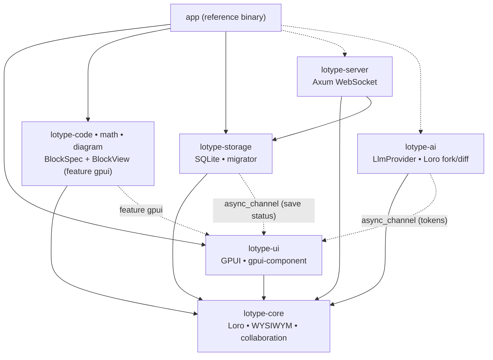

# Lotype Architecture

Lotype is a native Rust SDK for block-based document editors. It has two layers:

- **`lotype-core`**: a headless WYSIWYM engine with realtime collaboration, built on [Loro](https://github.com/loro-dev/loro). JS equivalent: ProseMirror + Yjs.
- **`lotype-ui`**: a WYSIWYG editor built on GPUI. JS equivalent: Tiptap + BlockNote + React.

Unlike the JS stack, these are two layers with a clear boundary, not three layers patching each other. There is no browser DOM and no WebView.

Status: **alpha**. License: **MIT OR Apache-2.0**.

**Name and identity.** The name comes from the *line-o'-type* machine, which cast a whole line of text as one solid metal slug, just as Lotype treats a document as blocks.

| | |
| :--- | :--- |
| Website | [lotype.dev](https://lotype.dev) |
| Docs | [docs.lotype.dev](https://docs.lotype.dev) |
| Document schema namespace | `https://lotype.dev/schema/v1` |
| Source | [github.com/lotype/lotype](https://github.com/lotype/lotype) |

---

## 1. Scope

| | |
| :--- | :--- |
| **Product** | An SDK published as crates on crates.io. The in-house editor is the first consumer. |
| **First-release consumers** | Rust/GPUI applications on macOS |
| **First-release platform** | macOS only: Intel (`x86_64`) and Apple Silicon (`aarch64`), shipped as a universal binary |
| **First-release features** | Realtime collaboration, cross-block text selection, nested blocks, tables (no merged cells), AI (selection prompt + multi-turn chat panel) |
| **Out of scope** | Windows, Linux, iOS, Swift consumers, video and audio blocks |

### 1.1 Why native

1. **WebView fragmentation.** `prosemirror-view` 1.43 has 60 browser-specific branches in 6,530 lines and 87 references to IME composition. They are concentrated in input, selection and keyboard handling. Under Tauri, the WebView version follows the OS, so it cannot be pinned.
2. **Layers patching each other.** In BlockNote 0.57 on top of Tiptap/ProseMirror:
   - one block is three ProseMirror nodes (`blockGroup` → `blockContainer` → `blockContent`);
   - block IDs are re-applied after every transaction via `appendTransaction`;
   - five helpers translate between positions and blocks;
   - menu logic in BlockNote's core package is coupled to the DOM.

Going native does not remove per-OS work. It moves that work to the OS text-input APIs (`NSTextInputClient` on macOS). Targeting only macOS in the first release keeps this to a single platform.

### 1.2 Future direction (not built in the first release)

The long-term goal is native macOS and iOS apps, including rich-text chat UIs. This is an unvalidated hypothesis, and the first-release architecture must not rule it out.

- **iOS.** `gpui-pre-ios` (Zed's `gpui_ios`) exists but is young: about 3.6k lines, against about 10k for the macOS backend.
- **Swift apps.** A future `lotype-ffi` crate (UniFFI) plus a native TextKit 2 editor, reusing `core`. `loro-swift` shows this pattern works.
- **Chat.** A restricted "chat" schema profile via the `BlockSpec` registry, using Markdown as the interchange format.

What keeps these doors open: `core` has no GPUI or OS dependencies, and the schema is extensible.

### 1.3 Migration from the legacy stack (Tauri + React + Tiptap/BlockNote)

| Legacy component | Decision | Target |
| :--- | :--- | :--- |
| ProseMirror model/state/transform | Replace | `lotype-core`: a Loro block tree with native IDs. `Pos { block, offset }` replaces integer positions. |
| `prosemirror-history` | Drop | `loro::UndoManager`, local-only, like `Y.UndoManager` |
| Yjs / y-prosemirror | Replace | `loro`: relative positions become `loro::Cursor`; awareness becomes `EphemeralStore` |
| Tiptap extensions + BlockNote specs | Merge | `BlockSpec` / `InlineSpec` / `MarkSpec` in core, `BlockView` in ui |
| React UI and editor view | Rewrite | `lotype-ui` (GPUI + `gpui-component`) |
| Legacy JSON documents | Port the schema; add a migrator | One-way `JSON (Tiptap/BlockNote) → Loro` in `lotype-storage`; `callout` becomes `alert` |
| Axum HTTP/SSE server | Repurpose | `lotype-server`: a WebSocket sync library the consumer mounts |
| Tauri IPC and WebView config | Retire | Remove all `#[tauri::command]` handlers, the JSON IPC and the WebView workarounds |
| Tokio LLM client logic | Port behind a trait | An `LlmProvider` implementation; keep the prompt builder and stream parser; output goes to `async_channel` |
| `@blocknote/xl-ai` | Design reference only | GPL-3.0 OR PROPRIETARY: no code is ported |

---

## 2. Crates

| Crate | Role | Depends on |
| :--- | :--- | :--- |
| `lotype` | Umbrella crate; re-exports behind feature flags | all |
| `lotype-core` | Block tree, schema, commands, selection, local undo, sync updates, awareness, Markdown | `loro`, `pulldown-cmark` |
| `lotype-ui` | GPUI editor and built-in blocks | `core`, `gpui-component` |
| `lotype-code` | Syntax highlighting for code blocks | `core`, `ui` (feature `gpui`) |
| `lotype-math` | LaTeX blocks and inline math | `core`, `katex-rs`, `katex-native`, `ui` (feature `gpui`) |
| `lotype-diagram` | Mermaid diagram blocks | `core`, `bezel-mermaid`, `ui` (feature `gpui`) |
| `lotype-server` | WebSocket sync as an embeddable Axum router; self-hosted by the consumer | `core`, `storage`, `axum` |
| `lotype-storage` | SQLite snapshots, debounced auto-save, migrator for legacy Tiptap/BlockNote JSON | `core`, `tokio` |
| `lotype-ai` | Selection prompt, multi-turn chat, LLM provider trait | `core`, `tokio` |
| `app` (binary) | Reference application that wires Tokio and GPUI together | all |

All dependencies point towards `core`. `core` never depends on GPUI, Tokio or any OS API.



---

## 3. Core / UI boundary

**Rule:** if it can be tested without a window, it belongs in `lotype-core`. If it needs pixels, the OS or GPUI events, it belongs in `lotype-ui`.

| `lotype-core` (no pixels, synchronous) | `lotype-ui` (GPUI) |
| :--- | :--- |
| Block tree (`LoroTree`) with inline content (`LoroText`) and marks | Block rendering, text layout (`TextRun` from marks), virtual list |
| Schema registry: `BlockSpec`, `InlineSpec`, `MarkSpec` | `BlockView` per block type |
| Commands: insert, update, move, split, merge, toggle mark | Hit-testing between pixels and `Pos`; drawing the cursor and selection |
| `Selection::{Text, Blocks, Cells}` | IME via `EntityInputHandler`, converting UTF-16 ↔ UTF-8 |
| Local undo/redo | GPUI actions → core commands (the keymap comes from core) |
| Input rules and paste rules | Slash menu, formatting toolbar and link toolbar views |
| Keymap as data | Side menu, drag handle, hover, drop, block geometry |
| Slash menu items, filtering and query state | System clipboard (core does the serialization) |
| Formatting state queries (active marks, block type) | Collaborator cursors (rendered from awareness) |
| Markdown in/out, clipboard serialization | |
| Sync: export/import updates as bytes; `EphemeralStore` | |

A custom block is a `BlockSpec` in core plus a `BlockView` in ui.

---

## 4. Document model (`lotype-core`)

Built on `loro` 1.18. The APIs below were checked in the crate source:

| Need | Loro API |
| :--- | :--- |
| Block tree with IDs and moves | `LoroTree::create_at`, `mov`, `mov_to`, `mov_after`, `mov_before`, `enable_fractional_index` |
| Rich text and marks | `LoroText::mark`, `to_delta`, `apply_delta`, `slice_delta` |
| Mark behaviour at range edges | `configTextStyle` with `expand: before / after / none / both` |
| UTF-8 / UTF-16 offsets | `insert_utf8`, `insert_utf16`, `delete_utf16`, `len_utf8`, `len_utf16`, `convert_pos` |
| Positions that survive remote edits | `get_cursor(pos, side)` → `Cursor` |
| Local undo | `UndoManager` (`set_merge_interval`, `add_exclude_origin_prefix`) |
| Movable lists | `LoroMovableList::mov` |
| Presence | `EphemeralStore` |

Design decisions:

- **Blocks** are `LoroTree` nodes, so every block has a native ID (`TreeID`) with no patching. A block's metadata map holds its type (`$type`), its text (`$text`, a `LoroText` created with the block so two peers never create it separately) and its attributes. Attribute keys starting with `$` are reserved.
- **No block is ever deleted.** Loro cannot revive a node it deleted: undoing the deletion makes a copy under a new `TreeID`, which loses what other peers did to the original and breaks every reference to it. So removing a block moves it, with everything in it, under a *trash node*: a node marked `$trash` in its metadata, which no method shows and no index counts. Undo moves the same block back, with its text, its children and whatever peers changed in it meanwhile. A new block is made in the trash as well, in a change outside the undo history, and inserting it is the move out; undoing an insertion therefore puts the block away, and redo brings that block back. `BlockId` is the `TreeID` and never changes. It prints and parses as text, so an application can keep references to blocks outside the document. Peers that each made a trash node before they met keep them all, and each removal uses the top-level one with the lowest ID. A node counts as trash wherever a peer has moved it, and a peer that takes the marker off turns it and its contents back into blocks on every peer alike. The trash is never emptied: a peer cannot know that no other peer will still undo a removal.
- **Positions** are `Pos { block: BlockId, offset: usize }`. Offsets are UTF-8 bytes and must fall on character boundaries; anything else is rejected. Conversion to UTF-16 happens only at the IME boundary in `lotype-ui`. Inside the editor, the selection and the selections stored with undo steps are also anchored with `loro::Cursor`, so they follow their text through changes from other peers. Undo steps use the exact byte offset until a remote edit changes the anchored text. When undo or redo puts back text the caret was in, Loro's undo history carries the stored endpoints through the remote changes, so the caret returns to the same place inside that text. Loro's place is also used for a range start when a peer removed the character before it. Where a peer removed the character at any other stored endpoint, the endpoint goes to where that character was. A range keeps both endpoint anchors across imports. When a peer replaces the selected text, the selection covers the replacement even if the deletion and insertion arrive separately. A selection whose blocks are gone is cleared, and returns if a later import brings the blocks back before the selection is set again.
- **Sync.** `Document::export_snapshot` gives the whole document, `Document::export_updates(&Version)` what a peer at that version lacks, and `Document::import` or `Editor::import` merges either. How the bytes travel is up to the application. Loro reports unreadable bytes as `Error::InvalidUpdate`. With a shallow history it can apply part of an update before returning that error. Importing from an editor goes through `Editor::import` outside any local edit. Remote changes stay out of undo history. One that touches the text being typed ends the current typing step, because Loro ends its undo group there.
- **Untrusted content.** Everything read from the Loro document may come from another peer, possibly one with a different schema, so the core never panics on it and never loses it:
  - Blocks of an unknown type are reported as such and skipped by range commands.
  - Marks outside the schema stay readable. Split, merge and range delete copy text and attributes as stored, so unknown marks and values survive.
  - Tree walks use an explicit stack, never recursion.
- **Nesting is capped at `MAX_DEPTH` (128 levels).** Deeper blocks sent by another peer stay in the shared data but are not part of the document: no method returns them, and local edits cannot create them. The cap bounds every ancestor walk, which keeps reads linear however deep a peer nests.
- **Undo** is local-only (`loro::UndoManager`). Consecutive typing shares one step until a keystroke starts a word after whitespace. Consecutive Backspace or Delete presses within a block share a step by direction. Changing the selection, toggling a mark or running another command ends the current step. Replacing the document through `Editor::apply` starts a fresh history with the replacement as its baseline. Loro can fail to undo a step that changes from other peers have cut across, and it keeps that step on its stack; `Editor::undo` then returns the error and clears the history, since no older step could be reached any more.
- **An edit is published after validation.** `Editor::apply` runs the callback on a private Loro fork. After the callback succeeds and its selection validates, the editor first makes the draft's new blocks in the trash, under the same IDs, and then replays the draft's operations as one undo step. The IDs agree because the draft makes blocks under the document's peer and everything else under a peer of its own. An error or panic discards the draft and preserves the document's blocks, the selection, and the history; a step on a document without a trash node adds one first, and that stays even then. The draft's update and snapshot exports are disabled. The editor keeps the fork between drafts and brings it to the document's version with the document's new changes and a checkout, so a draft costs what changed rather than the whole document. Drafts it served stay in its history off that version, under peers of their own. A block a draft makes before anything else is the same operation the document makes, and the fork serves on. A block made after other edits, or by a draft that failed, has an id the document will use differently, so the fork is made anew for the next draft, as it is once old drafts double its history. Single-keystroke typing and deletion use the live document to avoid a fork.
- **Input rules.** `Editor::insert_text` turns Markdown typed at the start of a paragraph into that block (`# ` to `##### `, `- `, `1. `, `[] `, `> `, `` ``` `` with or without a language and then a space, `---`) and puts a mark on text typed between `**`, `*`, `_`, `~~` or backticks. The patterns follow Tiptap and BlockNote. A rule only acts where its result fits. A block rule acts in a paragraph at the top level, not in one nested in another block, where what is typed stays text, for a block type the schema has, and not where a block with children would become one that takes none. A mark rule acts in any block with text except a code block and inline code, for an on/off mark the schema has. A rule is an undo step of its own, after the typing, so undo gives back what was typed.
- **Commands and keymap.** `Command` names what a key, a menu or a toolbar asks for (toggle a mark, set the block type, indent, outdent, undo, redo, Enter, Shift-Enter for a line break in the block, Backspace, Delete). In a quote or an alert, or a block in one, Shift-Enter breaks the line inside it and Enter leaves the nearest of them for a paragraph right after it, after an empty list item there has left its list, taking the text after the caret along, or taking an empty block there out as a paragraph, and an alert left empty goes; a cell keeps Shift-Enter as a line break and `Editor::run` does it. `default_keymap()` is the built-in table from key names to commands, with ProseMirror's key names and the bindings of Tiptap and BlockNote; the view turns its key events into those names and may add bindings of its own. Setting the block type replaces the block's attributes, all but its own style, `text_color`, `background_color` and `text_alignment`, which stays as BlockNote keeps its default props where the new type takes a style. A heading is never in another block, as its `BlockSpec` is built `top_level()`: a block that becomes one, by the slash menu, the toolbar or a key, and a heading pasted into a nest come out of every block they are in where they read, with what follows them there, so no block changes place on the page, and an alert left empty goes; `Document::move_block` refuses to put one in a block, so Tab, a drop and `Editor::move_blocks` leave it at the top level, and dragging one shows no place among nested blocks. Markdown reads a heading in a list item, a quote or an alert as a paragraph, the item's text where it leads. A peer can still nest one, and it is drawn where it is. A `BlockSpec` built `without_style()`, as the code block is and math and diagram blocks are to be, takes none: they are drawn in a style of their own. A block that is of the type already keeps all its attributes and only takes those given, so a checked item stays checked. `Editor::set_block_attr` sets or takes off an attribute on the selected blocks as one undo step, as the toolbar aligns them, leaving out tables and their rows, and the style of blocks that take none. It leaves a block as it is when the block cannot become that type: when one of the two holds text and the other does not, when the block has children and the type takes none, or when the block's own type is unknown here. `Editor::move_blocks` moves the selected blocks one step up or down the page in reading order, as one undo step: past the sibling before or after them, into the end or the start of that sibling's children where it has some (not a table's rows), or out before or after their parent at its edge; `Document::move_block_next_to` puts a block right before or after another, as a drop does. Indent makes a block the last child of the sibling before it. Outdent moves it out to follow its parent and takes the siblings after it along as its children, so no block changes place on the page; a block that cannot make the move stays.
- **Slash menu.** `default_slash_items()` lists the blocks the menu offers, all but the paragraph, which typing in an empty block gives already, each with a stable key, an English title, a subtext of what it is for, a group and aliases, each group together: Headings (1 to 3), Subheadings (4 and 5), Basic blocks, Advanced and Media, and `filter_slash_items` narrows them by what was typed, matching titles and aliases whatever the case. `Editor::slash_query` reports the query: the text between the caret and a `/` before it that starts a word, with no whitespace in it. `Editor::accept_slash_item` takes the query out and inserts the block, in place of the block the caret is in when that is left empty and below it otherwise, as one undo step. The caret goes into the new block, or where text can go next to it: a paragraph inside a container such as an alert, below a block such as a divider, or the first cell of a table, which starts out two by two. The view draws the menu and keeps the highlighted entry.
- **Paste.** `Editor::paste_text` inserts plain text as it is, as an undo step of its own, with the marks typing would get there; no input rule reads it. A pasted `http`, `https` or `mailto` address becomes a link on the selected text, or linked text of its own at a caret.
- **Change notifications.** `Editor::take_changes` returns what changed since it was last called: the blocks whose text, marks, type or attributes changed, whether blocks were inserted, removed or moved, and whether the editor got another document. It covers local edits, undo and redo, and imports alike, and it is pulled, not pushed: the view asks after each action or import and redraws only that. Blocks in the trash are never reported, so when blocks were inserted, removed or moved, the view reads every block that is new to it, including one that undo brought back. Selection changes are not part of it; the view reads `Editor::selection`.
- **Pending marks.** Toggling a mark on a caret sets the formatting for subsequent typing until the selection changes or another editing command runs. Use `Editor::set_mark` with an explicit value for links and colors. By default the editor uses the marks shared by the neighboring characters and the marks whose expand rules reach the caret. If both sides expand a mark with different values, the preceding value wins. `Editor::active_marks` reports the formatting for the next insertion at a caret or the shared formatting across a text selection.
- **Traversal.** Use `Document::blocks()` for a snapshot in document order. Neighbor and path queries share sibling indexes for the current document state.
- **Characters.** Backspace and Delete remove a whole grapheme cluster, including when the caret is between two scalars in that cluster. With a selection they delete the selection. At a block boundary they use a separate undo step for the structural edit. Backspace right after an input rule takes the rule back and leaves what was typed (`# ` stays text), as long as nothing changed since. At the start of a block that is no paragraph, Backspace makes it a paragraph first, keeping its text, its children and its style; another press joins it onto the block before it. The first block in an alert, which has no text to join onto, goes out before the alert, and an alert left empty goes. An empty paragraph at the very start of the document goes, and the caret to the text after it, where there is some; the only block stays to be written in. Delete in an empty last block that is no paragraph makes it one, and in an empty last paragraph takes it away as Backspace does; Backspace at the start of a block after a table goes to the end of the table's last cell, which takes no text from it, and takes the block away where it is empty, and Delete before an alert joins the alert's first block on, taking the alert away once it is left empty. Enter in an empty list item with nothing in it leaves the list: out a level from another list item, and into a paragraph otherwise.
- **Tables** are rows by columns, so that edits made at the same time cannot leave rows of different lengths:
  ```text
  table block ── $cols: LoroMovableList<ColumnId>     (a mergeable child of its metadata)
  ├── table_row block ── $cell:<ColumnId>: LoroText   (mergeable children of its metadata)
  └── table_row block ── ...
  ```
  A row is a block, so it is inserted, moved, removed and brought back by undo like any block. A column is an id in the table's list. A cell is a row and a column and is no node of its own: when one peer adds a row while another adds a column, the cell where the two meet needs nobody to make it. Its text is a *mergeable* child of the row's metadata (`LoroMap::ensure_mergeable_text`), which Loro gives the same identity on every peer, so what two peers type into a cell neither had before merges like any other text. Removing a column removes its id and keeps the text, which undo shows again. Two peers that both undo the removal of a column list its id twice; it counts once, where it is listed first, and so does anything else a peer writes into the list that is no id. A column's id is the id of the Loro operation that first listed it, in the document or in the draft of the edit that added it. A row keeps to its table, and a table needs room for its rows above `MAX_DEPTH`.
  A cell has a `BlockId` (its row with a column), and everything that reads or edits a block's text takes it: typing, marks, selections, undo, change notifications. It is not among `Document::blocks` or the children of its row; `Document::cell` gives it. `Selection::Cells` selects the cells between two corners. A cell cannot split, join, nest or change type: Enter in a cell goes to the cell below, Shift-Enter is a line break, and a text range may not run from a cell into another block. `Editor::add_row` and `Editor::add_column` add a row or a column where they are asked, and `Editor::delete_row` and `Editor::delete_column` take away the row or the column of a cell, each as one undo step with the caret in the cell where writing goes on; the last row or column takes the table with it, and the caret goes to the text after it, or before it, or to a paragraph in its place. `Document::cells_between` gives the cells of a `Selection::Cells`. A table two peers emptied of its columns or its rows still takes a row or a column, without a caret in it. A table, its rows and its cells are only shaped through the table methods.
  Loro notes that a cell has text in the row's metadata. An undo step holding that note would take the cell's text from view when undone, together with what any peer wrote there, so the editor writes the note before the step that first types in the cell, as it makes new blocks before the step that inserts them. Merged cells are deferred.
  This is not ProseMirror's model, in which each row holds its cells: there, a row and a column added at the same time leave the new row one cell short, and `prosemirror-tables` repairs that in every peer's `appendTransaction`, each peer writing its own fix.
- **Schema normalization.** A concurrent merge can produce a schema violation, such as a heading with children. Such violations are tolerated when rendering and are never written back to the document. If every peer wrote its own fix, the fixes could conflict with each other.
- **IME.** Text that is still being composed (*marked text*) lives in `ui` as a preview. It is committed to core only when composition ends, and its anchor is kept as a `loro::Cursor` in case remote edits arrive meanwhile.
- **Markdown.** `Document::insert_markdown` reads CommonMark with GitHub's alerts, task lists and strikethrough into blocks, using `pulldown-cmark` 0.13.6 (`ENABLE_GFM`, `ENABLE_STRIKETHROUGH`, `ENABLE_TASKLISTS`, `ENABLE_MATH`), and `Document::to_markdown` writes a document out. Block attributes carry what Markdown says beyond the type: `level` on a heading, 1 to `MAX_HEADING_LEVEL` (5), a deeper Markdown heading reading as the deepest, `start` on the first item of a numbered list that does not start at 1, `checked` on a check list item, `language` on a code block, `kind` on an alert, `url` and `caption` on an image, `url` and `name` on a file. The first paragraph of a list item or a quote is its text and the rest are its children. An image alone in a paragraph is an image block. A page break is written as `<!-- page-break -->`. A table is a GFM table (`ENABLE_TABLES`): its first row is the one Markdown puts headings in, a row shorter than its headings is filled up and the parser drops what a row has beyond them, a cell is written on one line, and a table without a row or a column is not written. Reading keeps what the schema lacks as plainly as it can: a block of a missing type becomes a paragraph, a missing mark is left off, math stays as its source text, and blocks nested deeper than `MAX_DEPTH` follow the block they could not go into. Writing escapes what Markdown would read as markup in text, and writes the character next to an emphasis sign as a character reference where the sign would not count otherwise; property tests check both by reading the result back. It leaves off what Markdown cannot say: underline and colors, the difference between a toggle list item and a bullet, a file block (written as a link), nesting under a block that is no list item, quote or alert, empty paragraphs, space at the ends of a block's text, and marks on space next to unmarked text.
- **Inline atoms.** An atom is something in a line of text that is not text, such as a mention or a formula: one U+FFFC character (`OBJECT`) carrying the mark `$atom`, whose value is a map of its type and scalar attributes. Being a character, it moves, merges, splits, deletes and undoes with the text around it as one grapheme, and can carry marks such as bold. The atom mark never shows among public marks, whatever value a peer gave it; a span is an atom when its `atom` is set. Typed text never takes the atom mark, even between two like atoms. Only types in the schema (`InlineSpec`) can be inserted, and each gives its atoms a plain text (`@Ann` for a mention), used for Markdown and the plain text on the clipboard, so that an atom is never lost there as Tiptap loses inline math. A peer's atom mark counts only on U+FFFC; on other characters it is ignored. ProseMirror needs a first arrow press to select some atoms and moves over others; here every atom is one step, and the source text of a formula, which BlockNote keeps as editable text, waits for `lotype-math`: attributes are scalars for now.
- **Clipboard.** `Document::slice` copies a selection into a document of its own: the selected text with the blocks it is in, keeping a block's parent when that is copied too, copying a table the selection goes through whole, and leaving out blocks of unknown types and marks the schema lacks. `Document::slice_blocks` copies whole blocks the same way, each with what is in it and once, however many of them are inside one another. That document is what the clipboard holds, whole: Markdown would lose underline, colors and atoms, where ProseMirror keeps them in HTML. `Editor::paste_document` pastes it back as ProseMirror pastes a slice, as one undo step: a single paragraph goes into the text at the caret with its marks; blocks go between the two halves of the block at the caret, a first paragraph joining the text before the caret and the text after the caret joining the last block that holds text; an emptied first half goes. A heading copied from its middle pastes as a heading. Code blocks and table cells take pasted text as plain text. `Document::insert_document` copies the blocks over, leaving out what the schema lacks, as reading a peer's update does: blocks of unknown types with what is in them, marks and atoms, and children under a type that takes none. A table is copied with the text of its cells; a paste with nothing the schema takes leaves the block at the caret whole. `Editor::paste_markdown` reads Markdown into a document and pastes that.

`loro-prosemirror` is not used as a model reference. It stores nodes in `LoroList` without `LoroTree`, so a block move becomes delete + insert, and concurrent edits to the moved block can be lost.

---

## 5. UI layer (`lotype-ui`)

- **GPUI.** `gpui-component` 0.10.0 depends on `gpui-pre = "=0.3.12"`. This is a GPUI snapshot republished by the gpui-component maintainer, not by the Zed team.
- **Platform.** `gpui-pre` holds no platform: the application picks one with `gpui-pre-platform`, so `lotype-ui` takes it only as a dev-dependency, for its example and visual checks. Its `runtime_shaders` feature compiles the Metal shaders at run time, so a Mac with only the Command Line Tools, without Xcode, can build and run the editor.
- **Compiler.** GPUI needs a newer compiler than the core, so `lotype-ui` declares `rust-version = "1.98"` (checked locally with `cargo +1.98 check -p lotype-ui --all-targets`), and the MSRV job skips it.
- **Text.** A block's text is `text_el`, an element of our own: GPUI's `StyledText` holds no elements inside its text, and draws a caret at a soft wrap only at the end of the upper line. Each span is one `TextRun` styled by its marks (`marks.rs`). Text between atoms is shaped whole with `shape_line`; each atom is an element, measured before layout (`layout_as_root`) and drawn in place of its character. Lines break greedily, never inside a grapheme, after spaces, around CJK characters, and, for a word wider than the line, between graphemes; each line walks its graphemes once and stops at the first that does not fit, and x positions come from a sorted table of glyph and atom edges, so a paragraph, even one long word, lays out in near-linear time; space at a line's end hangs past the edge, and an atom sticks to the words around it (`text_el/wrap.rs`). An atom is centred on the text, as CSS's `vertical-align: middle` puts it, and a taller one makes its line taller and pushes that line's text down. A probe of the text's own size, without a width, gets the last layout's size, as GPUI's own text answers it. Geometry answers `None` until the text is laid out, where GPUI's `TextLayout` panics (`text_el/geometry.rs`). Font size comes from the element around the text, so a heading sets it on a wrapping `div`. The view paints no background: that is the application's.
- **Canvas.** The blocks are one column of rows in document order, each indented by how deep it is nested, up to 16 levels so that deeper text keeps its room, so nesting needs no element per level and the column can become a virtual list (`editor/canvas.rs`). A list item has its marker in a slot before its text: a bullet, its number counted along its numbered siblings from the first one's `start`, a box that checks it as an undo step, or an arrow that opens and closes a toggle. Whether a toggle is open is the view's own state, not the document's, and a toggle opens when the selection goes into it; Enter in an open toggle writes in it, the text after the caret going into a paragraph as its first block, and in a closed one starts another toggle after it and keeps what it hides (`Editor::split_toggle`); closing one moves a selection inside it to the end of its text. Quotes and alerts draw a bar on every row inside them; the text of a quote and of everything in it is italic; and an alert's title, icon and colour are those of its kind on GitHub (Note, Tip, Important, Warning, Caution), or a note's for a kind GitHub lacks; a click on the title opens a menu of the five kinds, and picking one sets the alert's `kind` as one undo step (`editor/alert.rs`). Code blocks have a background, a divider is a rule, a page break, where printing and export start a new page, a dashed rule named "Page break" as word processors draw it, an image is drawn from its `url` with its caption, or its caption or address where it does not load, and a file is its name. A table is a grid of its cells, its first row the headings, in a header's weight and fill (`editor/table.rs`); a cell holds text as a block does, a click puts the caret in the cell under it, Tab and Shift-Tab go to the next and the cell before, Tab in the last cell starts a row, and Enter goes to the cell below, as in a spreadsheet, or from the last row into a new paragraph after the table, as Enter at the end of a block starts the next one. While the mouse is over a table, a bar below it adds a row and one on its right a column; they keep their room while hidden, so the grid does not move. The cell with the caret has a button for a menu that inserts a row above or below or a column left or right, and deletes the row or the column, its right edge under the button so that it opens over the table. A drag, Shift and a click, or Shift and an arrow past the edge of a cell's text, from one cell into another selects the cells between as `Selection::Cells`, painted as a selection, and Shift and an arrow then move the cell it ends in a cell at a time, within the table; Escape in a cell's text does nothing; Backspace and Delete empty them, and the table stays, copy and cut put them on the clipboard as a table of just those cells (`Document::slice_cells`) and, for other applications, as rows of tab-separated text, and any other key goes on from the cell the selection ends in, as from a caret there, Escape only going back to it. The bars, the menu and its button take the focus and end a composition, as a click in the text does. The view draws rows and columns that two peers added at the same time where they meet, with the cell between them. An empty paragraph with the caret in it, while the editor has the focus and nothing is being composed, says "Type '/' for blocks, Space for AI, or just write"; Space opens the AI prompt from milestone 6b on. A document with no blocks, new or emptied by a peer, shows the same words where its first block would be, and the first click, key or text there makes that block a paragraph with the caret in it, so that the document changes only once someone writes. The view scrolls, and a change of the selection or the text scrolls the caret, or the head of a range, into sight once it is laid out.
- **Atoms.** `EditorView::with_atom_view` draws atoms of one type with an element of the application's; any other atom is a chip with the plain text its `InlineSpec` gives it (`editor/render.rs`).
- **Taken from `gpui-component`:** `menu`, `popover`, `virtual_list`, `command`, `toolbar`, `tooltip`, `clipboard`, `highlighter`, along with its theme: `EditorView::new` sets gpui-component up unless the application did. Its popover and popup menu take the focus when they open, so a menu the user goes on typing under, such as the slash menu, is gpui-component's list items and popover style placed with GPUI's own `anchored` and `deferred`.
- **Written in-house:** `text_el`, the block text element. gpui-component's `Input` stores text in a `ropey::Rope`, so it serves only as a reference for implementing IME. gpui-base 0.10 lays out text with inline objects too, but privately, tied to its theme, and measures a paragraph with objects again every frame.
- **IME.** `EntityInputHandler` (`replace_text_in_range`, `replace_and_mark_text_in_range`, `marked_text_range`, `unmark_text`, `bounds_for_range`, `character_index_for_point`) works in UTF-16, mirroring `NSTextInputClient` (`editor/input.rs`). The system sees one block, the one the cursor is in. Text being composed stays in the view, drawn in place of the selection, and goes into the document only when committed, as one typed insertion: peers, input rules and the undo history never see half-composed text. The editor keeps the selection in place through remote edits, so the composition follows it. Taking a composition back leaves a selection it was replacing as it was.
- **Cursor and selection.** Arrows move by grapheme and cross into the next or previous text block; Alt moves by word, Command to the line's or the document's ends, as in macOS text fields; Shift extends (`editor/motion.rs`). Up and down keep to the x position they started from. A caret at a soft wrap is either at the end of the upper line or the start of the lower one: Command-Right and a click past a line's end put it at the end, anything else at the start. A click places the caret in the nearest block, Shift-click extends, a double click selects a word, a triple click the block, and dragging selects across blocks. The selection is painted see-through over the text, as a block's background color would hide it behind, and the caret in front of it (`editor/paint.rs`). The caret blinks as macOS blinks it, lit and dark 530 ms each, once it has rested 500 ms after it moved or the text changed, while it is a caret in the text of a focused editor in an active window (`editor/blink.rs`). Each blink draws the window again, and every frame lays out every block, so the view times its frames, from render to the caret's paint, and blinks only while one takes 8 ms or less, under 2% of a core at two a second: in a document too big for that the caret stays lit and costs nothing.
- **Side menu.** Left of the row the mouse is over, in a gutter the view keeps left of the top-level blocks, a `+` button adds an empty paragraph below the block, or takes the block where it is one, and types a slash there, which opens the slash menu; a handle opens the block menu when clicked, leaving the selection as it is, and when dragged moves it next to the row it is dropped on, above or below by the half of the row, among that row's siblings, as one undo step, with a line where it lands (`editor/side_menu.rs`). Below a row whose children show is before its first child. A block dropped into itself, or off the rows, stays, and a drop leaves the view scrolled where it is. The menu is centred on the block's first line of text as the last frame laid it out, so it sits right whatever the block's type does to that line, a heading's size or a code block's padding, where BlockNote keeps a table of offsets per type; it is centred on a short row without text, and at the top of a tall one. It stays 300 ms after the mouse leaves the rows or the window, and stays on when the mouse comes back in that time, so that it does not flicker away on the way to it. The block menu is BlockNote's drag handle menu (`editor/block_menu.rs`): Delete removes the selected blocks where the block is one of them, or else the block alone, and, for a block whose type takes a style, two rows of swatches give the block a text and a background color, BlockNote's named ones in its `text_color` and `background_color` attributes, or take it off. A block's colors go under its marks', and the side menu stays by the block while its menu is open; Escape, a click elsewhere or a choice closes the menu.
- **Block selection.** Escape selects whole the blocks a text selection is in, as `Selection::Blocks`, and Escape again goes back into the text; the selection is painted from the indent of each selected block over everything inside it, with a blue edge on its left, so that a nested block reads as selected apart from its parent (`editor/selection.rs`). Command-Shift-Up and Down move the selected blocks through `Editor::move_blocks`, as dragging their handle does; in the text, the same keys still select to the document's ends. Up and down then move from row to row and Shift extends; Enter goes back to the end of the text of the block the selection went to, or of the nearest block with text; Backspace or Delete removes the blocks, and an alert whose blocks all go with them, and leaves the caret at the end of the text before them, or the start of the text after them, and `Editor::delete_selection` leaves an empty paragraph where it would remove every block. Tab and Shift-Tab nest and unnest them through the keymap, and copy and cut take them whole. The toggles around selected blocks open, and closing a toggle that hides some selects the toggle instead; the head of a block selection is scrolled into sight as the caret is.
- **Slash menu.** While `Editor::slash_query` has a query and some of the view's slash items match it, a menu of them shows under the slash, or over it where there is no room below, while the editor has the focus (`editor/slash.rs`): each group under its name, each entry with its icon, title, subtext and the keys the view's keymap binds to the same block, as macOS menus show them (`⌥⌘1`), or `Ctrl+Alt+1` elsewhere. Menus and toolbars are placed from the last frame's layout, which is still there when a frame starts, and the view draws again in the next frame where the text was not laid out yet or has moved, as a scroll or a resize moves it (`editor/popup.rs`). The editor keeps the focus, so typing goes on narrowing the menu; Up and Down move the highlight and wrap around, Enter or Tab take the highlighted entry through `Editor::accept_slash_item`, a click takes the entry clicked, and Escape closes the menu until the query ends. A new query starts at the first entry, at the top of the list. `EditorView::with_slash_items` replaces the core's `default_slash_items`.
- **Formatting toolbar.** Over a text selection that is not being dragged out, while the editor has the focus, a toolbar has BlockNote's formatting toolbar's items (`editor/toolbar.rs`, `editor/toolbar_menus.rs`): a select of the type of the block the selection starts in, for paragraphs, headings 1 to 5, quotes and the four lists, with a check on the current one, shown where the block is one of those; a button for each of bold, italic, underline, strike and code that the schema has; left, center and right alignment, for blocks that take a style, which `text_el` lays out by moving each line right in the room it leaves; the text and background colors of the selected text as marks, BlockNote's named ones; nest and unnest; and the link. A button shows as selected where all of the selection has its mark, or the block its type or alignment, and never takes the focus. A dropdown hangs from its button, which shows as selected while it is open: the color dropdown from the color button's left edge, as the button was laid out last, the select's from the bar's start; under the bar, or over it where there is not room enough under it and more room over it, as the bar and the dropdown were laid out last, so that it never covers the bar; it is drawn last, in front of the bar's buttons, and takes its clicks alone; it closes on a choice, a click elsewhere or any key. The toolbar goes under the selection where there is no room over it. The icons are Lucide's, built into the crate (`assets/icons`, ISC) so that no application has to give GPUI an asset source; gpui-component's own icons and dropdown caret are such assets and are not used. Where an edit moves the text a popup goes next to, as an alignment does, the popup follows in the next frame.
- **Links.** The formatting toolbar's Link button opens a field for the address of the selected text, a gpui-component input holding the address the text has (`editor/link.rs`). The field takes the focus, and the editor, which ignores keys while it does not have the focus itself, keeps its selection meanwhile, following peers' edits. Enter links the text to the address, or unlinks it for an empty one, and Escape leaves it as it was; both give the editor the focus back. A click elsewhere closes the field and leaves the focus where it went, and switching to another application keeps the field open. Under the link the caret is in, unless the slash menu shows there, a toolbar shows the address with Edit, Remove and Open, which act on the link as it is when clicked; Open is there only for `http`, `https` and `mailto` addresses, as a peer's link must not launch whatever application another scheme names.
- **Clipboard.** Copy puts the selection on the system clipboard as plain text, blocks joined by line breaks and atoms as their plain text, with the slice's Loro snapshot as metadata, in hex after a `lotype/loro` tag (`editor/clipboard.rs`): every GPUI application keeps metadata under the same pasteboard type, and Zed puts JSON there. Paste imports those bytes into a document with the editor's schema and pastes it through `Editor::paste_document`; bytes that do not import, more than 64 MiB of hex, a copy that cannot go where the caret is, and anything else paste as plain text through `Editor::paste_text`. Cut is copy and delete.
- **Keys.** A key down is named as the core's keymap names keys (`Mod-Shift-z`) and runs the bound `Command` (`editor/keys.rs`); unbound keys go on to text input. While text is being composed, keys are the IME's. `EditorView::with_keymap` replaces the bindings.

### 5.1 Blocks

Blocks are split into crates the same way BlockNote splits its packages. Every block crate exposes a GPUI-free `BlockSpec` and a `BlockView` behind the `gpui` feature, so block logic still runs in Linux CI.

| Crate | Contents | Renderer |
| :--- | :--- | :--- |
| `lotype-ui` | Blocks: Paragraph, Heading, Quote, Alert, Bullet/Numbered/Check/Toggle list, Code (plain), Table, Image, File, Divider, PageBreak<br/>Styles: bold, italic, underline, strike, code, text color, background color<br/>Inline: text, link | `text_el` |
| `lotype-code` | Syntax highlighting | gpui-component `highlighter` |
| `lotype-math` | Block and inline LaTeX | `katex-rs` + `katex-native` |
| `lotype-diagram` | Mermaid diagrams | `bezel-mermaid` |

Math and diagram blocks store their **source text** (LaTeX or Mermaid) in a `LoroText`, and their specs are built `without_style()`, as the code block's is. They can be edited collaboratively, and the renderer can be swapped without migrating documents.

**Alert.** GFM alerts (`> [!NOTE]`, `TIP`, `IMPORTANT`, `WARNING`, `CAUTION`) map to `pulldown-cmark`'s `BlockQuoteKind`. An alert is a container block. The migrator converts legacy `callout` blocks to `alert`.

**Diagrams: `bezel-mermaid` 0.2.29.** MIT licensed. It is a Rust port of Pele 1.6.0, follows Mermaid 12.1.0, and supports 33 diagram types.
- `render(source, &options, &host)` returns `Drawing { svg, width, height, links }`.
- `Host::width` is implemented with GPUI's text system, so labels are measured with the editor's font.
- The SVG is shown via `gpui::Image::from_bytes(ImageFormat::Svg, ..)` and rasterized by `resvg` at 2×.
- The fonts loaded into `resvg` must match the fonts `Host` measures with, or labels may be clipped. Because the output is raster, zooming requires re-rendering.
- `flowmaid` was rejected because it is GPL-3.0.

**Math: `katex-rs` 0.3.0 + `katex-native` 0.1.1.**
- `katex-rs` uses KaTeX's grammar, the same one BlockNote documents use, so legacy formulas stay valid.
- `katex_native::layout(&ctx, tex, display)` returns a display list (`Layout { width, height, depth, items }`) that GPUI draws natively:
  - text uses KaTeX fonts loaded via `TextSystem::add_fonts`;
  - rectangles and lines use `paint_quad`;
  - paths use `PathBuilder` + `paint_path`.
- Output stays sharp at any zoom level.
- Inline math is an inline atom, drawn by `text_el` with its own width. Atoms are centred on the text for now; a formula that must sit on the text's baseline will need its view to report one.

---

## 6. Collaboration (`lotype-server`)

`lotype-server` is a library: an Axum router that the consumer mounts in their own server and hosts themselves. Lotype does not issue tokens; it calls consumer-provided hooks:

```rust
trait Authorizer {
    async fn authorize(&self, token: &str, doc_id: &DocId) -> Result<Access, AuthError>;
}
enum Access { Read, Write }

trait DocStore { // default implementation: lotype-storage
    async fn load(&self, doc_id: &DocId) -> Result<Option<Vec<u8>>>;
    async fn append_update(&self, doc_id: &DocId, update: &[u8]) -> Result<()>;
}
```

The server **rejects updates from clients with `Read` access**, because clients are untrusted. `core` stays transport-agnostic: it only exports and imports update bytes.

---

## 7. AI (`lotype-ai`)

There are two entry points:

- a **prompt on a text selection**, opened from the formatting toolbar or `/ai`;
- a **multi-turn chat panel** that works on the whole document.

AI edits stay **private until the user accepts them**.

### 7.1 Flow

```text
main LoroDoc ──fork()──► AI fork (own PeerID, origin "ai"), never synced
                              │  LLM stream → add/update/delete ops applied incrementally
                              ▼
          ui: diff(base, fork) → suggestion overlay + local AI cursor
                              │  later chat turns keep editing the same fork
      Accept: main.apply_diff(diff) → a local op, so one undo step; then syncs normally
      Reject: drop the fork         → main is never touched
```

- **Session.** An `AiSession` holds the message history, the fork and `base_frontiers`. The diff is always taken against `base_frontiers`, so repeated revisions produce a single review.
- **Context.** The model receives `DocumentState`. With a selection, that is the selected blocks plus the whole document. Without one, it is the whole document plus a cursor marker. Block content is sent as Markdown per block, and the tool schema is generated from the `BlockSpec` registry.
- **Tools.** `add { referenceId, position: before|after, blocks }`, `update { id, block }` and `delete { id }`.
- **Streaming.** A partial-JSON parser validates each operation against the schema and applies it to the fork. The text reveal is animated in `ui` only, with token coalescing of about 16 ms. Dropping the stream cancels the request.
- **Chat history** is persisted by the consumer, not stored in the document, so it never syncs to collaborators:
  ```rust
  trait AiSessionStore {
      async fn load(&self, doc_id: &DocId, session_id: &SessionId) -> Result<Option<AiTranscript>>;
      async fn save(&self, doc_id: &DocId, session_id: &SessionId, transcript: &AiTranscript) -> Result<()>;
  }
  ```

### 7.2 Provider

```rust
pub trait LlmProvider: Send + Sync {
    /// Dropping the returned stream cancels the request.
    fn stream(&self, request: LlmRequest) -> BoxStream<'static, Result<LlmEvent, LlmError>>;
}
pub enum LlmEvent { TextDelta(String), ToolCallDelta { id: String, name: String, args_delta: String }, Done }
```

Consumers bring their own provider and API keys.

### 7.3 Split

| `lotype-ai` (no GPUI, runs in Linux CI) | `lotype-ui` |
| :--- | :--- |
| `AiSession`, state machine, multi-turn history | Selection prompt (formatting toolbar, `/ai`) |
| `DocumentState`, tool schema from `BlockSpec` | Chat panel |
| Partial-JSON parsing, op validation, applying ops to the fork | Suggestion overlay with Accept / Reject / Retry |
| Fork, diff, accept, reject | AI cursor and reveal animation |
| `LlmProvider`, `AiSessionStore`, `MockProvider` (test-support) | `EditorTestContext` flows for AI |

State machine: `closed → user-input → thinking → ai-writing → user-reviewing → closed`, plus `error → retry` and `abort`.

**Prior art.** The concepts come from `@blocknote/xl-ai` and `@tiptap/ai-toolkit`. `@blocknote/xl-ai` is licensed GPL-3.0 OR PROPRIETARY, so **none of its code is ported**.

---

## 8. Testing

**Tools:** `cargo test`, `insta` (snapshots of the document tree and Markdown), `proptest` (collaboration convergence).

| Layer | What is tested | How |
| :--- | :--- | :--- |
| Core unit | Commands, split/merge, marks, undo | `cargo test` + `insta` |
| Convergence | N peers apply random ops and sync in random order; they must end identical and keep schema invariants | `proptest` |
| Fixtures (only when needed) | Markdown, legacy JSON, Mermaid, LaTeX, stored in `crates/<crate>/tests/fixtures/<scope>/` | `cargo test` + `insta` |
| UI headless | Typing, shortcuts, cross-block mouse selection, menus. IME is driven by calling `EntityInputHandler` directly, because `simulate_input` only sends keystrokes | `#[gpui::test]` + `VisualTestContext` |
| Visual regression | Canvas screenshots compared with references | `capture_screenshot` (local only) |
| Collaboration E2E | In-process Axum server with two WebSocket clients | `tokio::test` |
| Performance | Keystroke-to-paint latency, opening 10k blocks, scrolling, memory | criterion + frame timing |
| Manual | Japanese/Chinese/Korean IME, dictation, VoiceOver, on Intel and Apple Silicon | Release checklist |

All tests are pure Rust. The local, gitignored `porting/` directory is reading material only and is never used as a test oracle.

### 8.1 `test-support` (shipped in the first release)

The test helpers are public, gated behind `#[cfg(any(test, feature = "test-support"))]`, so SDK consumers can test their own blocks:

- **Document builders** in core. Selection markers `<a>` and `<b>` follow `prosemirror-test-builder`:
  ```rust
  let mut ed = editor(blocks![p!["Hello <a>wor", b!["ld"], "<b>"], h1!["Title"]]);
  ed.toggle_mark("italic")?;
  assert_editor(&ed, blocks![p!["Hello <a>", i!["wor", b!["ld"]], "<b>"], h1!["Title"]]);
  ```
- **Collaboration helpers:** `peers(..)`, `sync(&a, &b)`, `assert_converged!`, and an exported proptest strategy `arb_ops::<MyBlock>()`.
- **Spec checks:** `assert_spec_roundtrip::<MyBlock>(markdown)`.
- **`EditorTestContext`** in ui wraps `VisualTestContext`, uses the same markers, and adds `ime_compose(..)` / `ime_commit()`.
- **`MockProvider`** in ai: a scripted, deterministic LLM stream.

### 8.2 CI

CI runs from alpha onwards, on a Linux runner. `core`, `storage`, `server`, `ai` and the block specs do not depend on GPUI, so CI also guards the architecture boundary: if GPUI code leaks into them, the build fails. UI tests run locally on macOS.

```text
cargo fmt --check
cargo clippy --workspace --exclude lotype-ui --all-targets -- -D warnings
cargo test   --workspace --exclude lotype-ui
find crates -name '*.rs' -exec wc -l {} + | awk '$2 != "total" && $1 > 600 { print; bad = 1 } END { exit bad }'
```

Local builds and CI use the same toolchain, pinned in `rust-toolchain.toml` (Rust 1.100.0, with rustfmt and clippy); CI installs it with `rustup toolchain install`. Upgrading the toolchain means changing that one file. `lotype-ui` is excluded because its tests need macOS; run `cargo clippy` and `cargo test` for the whole workspace locally before pushing. The binary crate will be excluded the same way. A second job runs `cargo check --workspace --exclude lotype-ui` on Rust 1.90 to back the declared MSRV. A third runs `cargo deny check` against `deny.toml`: RustSec advisories, a license allow-list with nothing copyleft that would bind applications using the SDK, and crates.io as the only source. `cargo-semver-checks` and `cargo publish --dry-run` will be added before the first crate is published.

---

## 9. Workspace layout

```text
lotype/
├── Cargo.toml
├── ARCHITECTURE.md
├── assets/                 # Fonts, SVG icons, GPUI themes
├── porting/                # Local-only reading material (gitignored): JS packages + Rust sources
└── crates/
    ├── app/                # Reference binary: main.rs, wiring.rs
    ├── core/src/
    │   ├── schema.rs       # BlockSpec / MarkSpec registry, built-in blocks and marks
    │   ├── document.rs     # LoroDoc wrapper: block tree, types, attributes
    │   ├── order.rs        # Document order: traversal, paths
    │   ├── trash.rs        # Removed and new blocks: the trash node
    │   ├── table.rs        # Tables: rows, columns, cells
    │   ├── text.rs         # Rich text and marks
    │   ├── marks.rs        # Marks in effect at a position and over a range
    │   ├── selection.rs    # Pos, Selection
    │   ├── commands.rs     # Split, merge, range delete, marks across blocks
    │   ├── editor.rs       # Editor: selection, undo steps, pending marks
    │   ├── editor/typing.rs  # Typing and deleting runs, grapheme deletes
    │   ├── editor/remote.rs  # Importing changes from other peers into an editor
    │   ├── editor/transaction.rs  # Stage fallible edits before publishing them
    │   ├── draft.rs        # What a staged edit did, to replay it on the document
    │   ├── editor/history.rs  # Undo and redo with the cursors Loro keeps per step
    │   ├── editor/changes.rs  # What changed, for a view to redraw
    │   ├── editor/input.rs  # Applying input rules to what was typed
    │   ├── editor/blocks.rs  # Block type, indent, outdent, paste
    │   ├── keymap.rs       # Commands and the default keymap
    │   ├── suggestion.rs   # Slash menu items, filter, query
    │   ├── markdown/read.rs, write.rs  # Markdown <-> block tree
    │   ├── rules.rs        # Input rules: what typed text turns into
    │   ├── atom.rs         # Inline atoms
    │   ├── clipboard.rs    # A selection as a document of its own
    │   ├── collab.rs       # Update export/import, selections that follow remote changes
    │   ├── value.rs, error.rs
    │   ├── test_support.rs # [feature "test-support"]
    │   │   # planned:
    │   ├── presence.rs     # EphemeralStore
    │   ├── normalize.rs    # Read-time schema tolerance
    ├── ui/src/
    │   ├── editor.rs       # EditorView: the blocks' text
    │   ├── editor/canvas.rs # Blocks as indented rows, list markers, bars
    │   ├── editor/render.rs # A block's text and atoms as an element
    │   ├── editor/clipboard.rs # Copy, cut and paste
    │   ├── editor/input.rs # Typing and IME composition
    │   ├── editor/keys.rs  # Keys to core commands
    │   ├── editor/motion.rs # Cursor movement, hit-testing, the mouse
    │   ├── editor/paint.rs # Selection and caret
    │   ├── editor/blink.rs # The caret's blinking, within a frame budget
    │   ├── editor/selection.rs # Whole blocks as the selection
    │   ├── editor/slash.rs # The slash menu
    │   ├── editor/toolbar.rs # The formatting toolbar
    │   ├── editor/toolbar_menus.rs # Its block type and color dropdowns
    │   ├── icons.rs        # Lucide icons built in from assets/icons
    │   ├── editor/link.rs  # The link field and toolbar
    │   ├── editor/side_menu.rs # Add a block, select it, drag it
    │   ├── editor/block_menu.rs # Delete a block, color it
    │   ├── editor/popup.rs # Where menus and toolbars go
    │   ├── marks.rs        # Text runs from marks
    │   ├── text_el.rs      # The block text element; wrap.rs, geometry.rs
    │   ├── test_support.rs # EditorTestContext [feature "test-support"]
    │   │   # planned:
    │   ├── editor/         # actions.rs, block_view.rs
    │   ├── components/     # table,
    │                       # collab_cursors, ai_prompt, ai_panel, ai_review
    ├── code/               # lotype-code
    ├── math/               # lotype-math
    ├── diagram/            # lotype-diagram
    ├── server/src/         # router.rs, auth.rs, store.rs
    ├── storage/src/        # sqlite.rs, debouncer.rs, migrator.rs
    └── ai/src/             # provider.rs, session.rs, store.rs, context.rs, tools.rs,
                            # stream.rs, review.rs, prompts.rs, test_support/
```

Root `Cargo.toml` (target state; `members` grows as each crate's milestone starts):

```toml
[workspace]
resolver = "3"
members = [
    "crates/app",
    "crates/core",
    "crates/ui",
    "crates/code",
    "crates/math",
    "crates/diagram",
    "crates/server",
    "crates/storage",
    "crates/ai",
]
exclude = ["porting"]       # local reference crate (porting/rust-ref) must not join the workspace

[workspace.package]
version = "0.1.0-alpha.0"
edition = "2024"
rust-version = "1.90"
license = "MIT OR Apache-2.0"
description = "A native Rust block-based document SDK: WYSIWYM engine with realtime collaboration (Loro) and a GPUI WYSIWYG editor."
homepage = "https://lotype.dev"
documentation = "https://docs.lotype.dev"
repository = "https://github.com/lotype/lotype"
keywords = ["editor", "wysiwyg", "wysiwym", "gpui", "crdt"]
categories = ["text-editors", "gui", "asynchronous"]

[workspace.dependencies]
loro = "1.18.0"
gpui-component = "0.10.0"   # pulls in gpui-pre = "=0.3.12"
pulldown-cmark = "0.13.6"
bezel-mermaid = "0.2.29"
katex-rs = "0.3.0"
katex-native = "0.1.1"
```

---

## 10. Milestones

There is a single release. Work is ordered so the riskiest parts that can be tested without UI come first.

| # | Milestone | Verified by |
| :--- | :--- | :--- |
| 1 | core: blocks, text, marks, split/merge, cross-block ops, undo, builders | `cargo test` (CI) |
| 2 | core: update export/import, multi-peer convergence including grid tables, positions that survive remote edits, read-time schema tolerance, change notifications for the UI, input rules, paste rules and keymap, slash menu items, Markdown in/out | `proptest`, `cargo test` (CI) |
| 3 | ui: single-block text (cursor, selection, `TextRun`, clipboard, IME, inline atoms) | `EditorTestContext` + manual IME |
| 4 | ui: canvas, cross-block selection, menus, toolbar, side menu, nested blocks | `#[gpui::test]` |
| 5 | server + storage: WebSocket relay, `Authorizer`, `DocStore`, collaborator cursors | `tokio::test` E2E |
| 6 | ui: tables | `#[gpui::test]` + convergence |
| 6a | ai headless: session, tools, partial streaming, fork/diff/accept/reject, plus the concurrent-accept spike. Can start after milestone 2 | `MockProvider` (CI) |
| 6b | ui: selection prompt, chat panel, review overlay | `EditorTestContext` + `MockProvider` |
| 7 | Reference app as a universal macOS binary | Manual checklist |

---

## 11. Open risks

| Risk | Plan |
| :--- | :--- |
| `gpui-pre` is a third-party GPUI snapshot pinned at `=0.3.12`, and consumers inherit the pin | Accepted for alpha; re-evaluate before a stable release |
| Accepting AI edits after collaborators have changed main: correctness of `apply_diff` on a changed document is unproven. Importing the fork's updates instead merges correctly, but the result is not undoable | Spike in milestone 6a |
| macOS 26 may be the last macOS release for Intel | Verify; this sets the deployment target and test matrix |
| No performance baseline from the legacy Tauri app | Measure latency, open time, memory and scroll FPS |
| `katex-native` is very new (0.1.1) | Fallback: keep `katex-rs` as the parser and write our own display list |
| Builder markers `<a>`/`<b>` clash with literal `<a>`/`<b>` in test text | Accepted: test-only; write such text through the document API instead |
| `heapless` 0.7/0.8 (pulled in by `loro`) has unsoundness advisories fixed only in 0.9.4. Loro and `postcard` use just `heapless::Vec`/`String`; the one advisory touching those (`vec::IntoIter` drop) needs an element whose `Drop` panics, which Loro's elements do not | Accepted; goes away when Loro moves to heapless 0.9 |
| The core uses whitespace boundaries to group typing and has no clock for pause detection | The UI can call `Editor::finish_edit_group` when its typing timer expires |
| `Editor::apply` rebuilds its fork from a snapshot after a draft that made a block after other edits (paste, most slash items), about 50 ms at 5000 paragraphs; Enter and commands that make no block reuse it (about 1–5 ms) | Profile command latency on large documents during the performance milestone |
| Removed blocks stay in the document, so it only grows. Emptying the trash would let a peer's undo of an older removal find its block deleted, and Loro then restores a node without text | Accepted for now; needs a rule for when no peer can undo a removal any more, with the sync protocol in milestone 5 |
| A peer that deletes a node outright, as no version of this core does, makes other peers' undo of an older move of that node restore a block without type or text. If the node is a trash node, undoing an insertion can no longer put the block away: Loro reports no change, and the editor goes on to undo the step before it | Accepted; such a block is reported as unknown and skipped, like any block of an unknown type |
| Undo puts a removed block back where it was, even when a peer has moved it elsewhere meanwhile | Accepted; it is what undoing the removal means |
| A selection endpoint on a character a peer deleted is resolved again on every import, and Loro's lookup for it slows as that block gets more edits (about 6 ms per import after 10,000 typed characters in a release build), until the selection is set again | Acceptable now; revisit with the performance milestone |
| The caret stops blinking where a frame takes more than 8 ms, about a thousand paragraphs, as every blink lays out every block | Blinks everywhere once the rows are a virtual list |
| Every frame lays out the text of every block again: GPUI caches shaped runs for two frames, but wrapping and atoms are measured anew (each atom is an element laid out on its own, about 1 ms in a debug build) | Acceptable for now; cache layouts per block and draw only visible blocks in the performance milestone, with the canvas's virtual list |
| Line breaking follows spaces and CJK only, not all of UAX #14 (GPUI's ICU breaker is private) | Acceptable for Latin and CJK text; revisit for Thai, Lao and others |
| Adding a column reads all the columns of its table, so making a table costs the square of its width (about 0.6 s for 1,000 columns in a release build) | Acceptable now: such tables are not what an editor shows; revisit with the performance milestone |
| Inserting a block among the top-level blocks anywhere but first or last lists all of them, to step over the trash node, so reading a long Markdown text into the middle of a long document takes time quadratic in its blocks (about 4 s for 16,000 paragraphs in a release build) | Acceptable now; revisit with the performance milestone |
| `Version` cannot be sent to another peer yet, so a peer cannot ask for exactly what it lacks | Add an encoding with the sync protocol in milestone 5 |
| A split or merge is delete + insert in the CRDT, so a concurrent edit to the moved text can be lost | Accepted; inherent without a native split operation |
| Content only a peer with another schema can create is kept but not fully understood: a mark outside the local schema keeps its value when text moves but then follows the local default expand rule (none), and an attribute that is itself a container is not copied to the new block on split | Accepted; revisit with schema negotiation in the collaboration milestone |
| Each accessor checks that its block is in the document by walking its ancestors, at most `MAX_DEPTH` steps; reading a whole document nested near the cap is correspondingly slower than a flat one | Accepted bound; a liveness cache is the fix if profiling calls for it |

---

## 12. Code conventions

- **File size:** aim for 500 lines or fewer; up to 600 is tolerated; above 600 fails CI. Split into new modules as features grow.
- **Structure:** modular, with one responsibility per module. YAGNI: no abstractions, options or traits until they are needed.
- **Comments:** only where they explain *why*. `///` becomes public rustdoc, so keep it short and do not restate the signature. Code blocks in `///` run as doctests, so include only real examples that compile.
- **Tests:** pure Rust. Fixtures only when needed, kept next to the code they test.
- **Language:** English for all code, identifiers, comments and repository docs.
- **Commits:** Conventional Commits, enforced by `committed` 1.1.12 (`committed.toml`) through the `.githooks/commit-msg` hook locally and the `commits` CI job. Setup is in [CONTRIBUTING.md](CONTRIBUTING.md).
