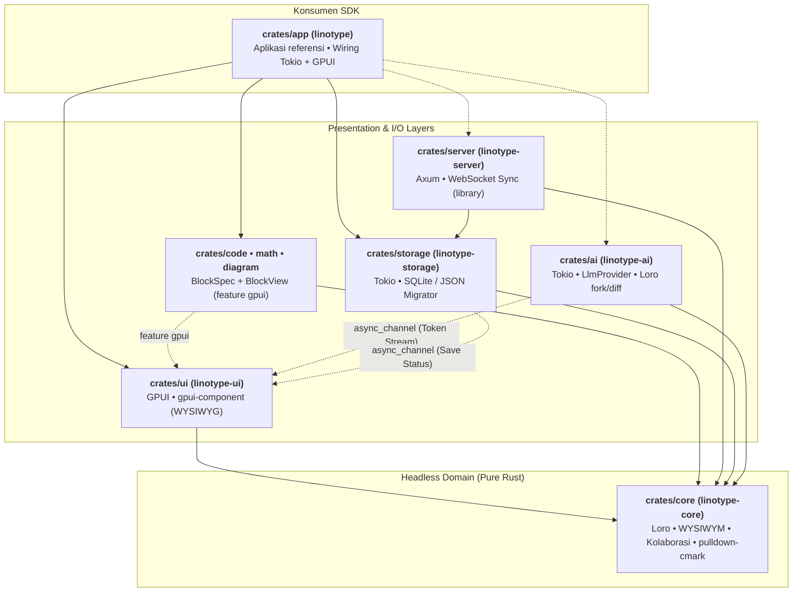

# Linotype (`lotype.dev`) — Architecture & Ecosystem Blueprint

**Linotype** adalah **SDK editor dokumen berbasis blok** native Rust: *engine* **WYSIWYM** dengan **kolaborasi real-time** (`linotype-core`, di atas Loro) dan lapisan **WYSIWYG** berbasis **GPUI** (`linotype-ui`), tanpa ketergantungan pada Browser DOM maupun WebView. Padanannya di ekosistem JS: `linotype-core` ≈ ProseMirror + Yjs, `linotype-ui` ≈ Tiptap + BlockNote + React — namun disatukan tanpa lapisan yang saling menambal.

> **Status:** Alpha — blueprint hasil validasi brainstorming (2026-11-20). Bagian bertanda *belum divalidasi* masih perlu dibahas sebelum dipindahkan ke `ARCHITECTURE.md`.

---

## 1. Identitas & Strategi Penamaan

* **Nama Ekosistem Crate:** `linotype` — terinspirasi dari mesin cetak *line-o'-type* yang mencetak satu baris teks menjadi satu blok logam utuh. Nama ini merepresentasikan model dokumen berbasis blok (*block-based*).
* **Domain & Identitas Web:** `lotype.dev` — kependekan enam huruf dari *line-o'-type* untuk dokumentasi (`docs.lotype.dev`) dan skema protokol (`https://lotype.dev/schema/v1`). Organisasi GitHub: **`github.com/lotype`**.
* **Rangkaian Paket `crates.io`:**
  * `linotype` — *Umbrella crate* (re-export modul utama melalui *feature flags*)
  * `linotype-core` — *Headless* WYSIWYM engine + kolaborasi real-time (Pure Rust, Loro)
  * `linotype-ui` — Editor WYSIWYG native berbasis GPUI + `gpui-component`, termasuk blok bawaan
  * `linotype-code` — Blok kode dengan *syntax highlighting* (padanan `@blocknote/code-block`)
  * `linotype-math` — Blok & inline rumus LaTeX via `katex-rs` + `katex-native` (padanan `@blocknote/math-block`)
  * `linotype-diagram` — Blok diagram Mermaid via `bezel-mermaid` / Pele (padanan `@blocknote/diagram-block`)
  * `linotype-server` — *Library* sinkronisasi WebSocket berbasis Axum (di-*host* sendiri oleh pemakai SDK)
  * `linotype-storage` — Persistensi lokal (SQLite) & migrator dokumen JSON lama
  * `linotype-ai` — AI inline (prompt dari seleksi) + panel chat multi-turn untuk seluruh dokumen; *trait provider* LLM (Tokio)

---

## 2. Positioning Produk

| Aspek | Keputusan |
| :--- | :--- |
| **Bentuk produk** | **SDK** (crate di crates.io, analog paket npm seperti Tiptap/BlockNote). Produk editor milik sendiri adalah **konsumen** SDK (*dogfooding*). |
| **Pemakai SDK rilis pertama** | Aplikasi **Rust/GPUI di macOS**. Aplikasi Swift (UIKit/SwiftUI/AppKit) **belum** dilayani. |
| **Target rilis pertama** | **macOS saja — Intel (`x86_64`) & Apple Silicon (`aarch64`)** sebagai *universal binary*. Windows/Linux menyusul. |
| **Cakupan rilis pertama** | Kolaborasi real-time, seleksi teks lintas-blok, blok bersarang (*nested*), tabel (**tanpa** *merged cells*), dan **AI** (prompt seleksi + panel chat multi-turn). |
| **Alasan Rust native** | (1) Kepemilikan *engine* & performa; (2) menghapus fragmentasi engine browser antar-OS. |

### 2.1 Masalah yang Diselesaikan (Tervalidasi)

1. **Fragmentasi WebView antar-OS.** `prosemirror-view` 1.43 memuat **60 percabangan khusus browser** dalam 6.530 baris (Chrome 15, Safari 14, Mac 12, Gecko 10, Android 9) dan **87 referensi *composition*** — terpusat di `input.ts`, `capturekeys.ts`, `domchange.ts`, `selection.ts` (IME, seleksi, keyboard). Di Tauri, versi engine mengikuti OS (WKWebView/WebView2/WebKitGTK) sehingga tidak terkendali.
2. **Lapisan BlockNote ↔ Tiptap/ProseMirror saling menambal** (BlockNote 0.57):
   * Satu blok = **3 node ProseMirror** (`blockGroup` → `blockContainer` `"blockContent blockGroup?"` → `blockContent`).
   * ID blok **ditambal** lewat `appendTransaction` (ekstensi `uniqueID` → `setNodeMarkup` setelah setiap transaksi).
   * **5 penerjemah posisi↔blok** (`getBlockInfoFromPos`, `NearPos`, `FromSelection`, `FromNode`, `At`).
   * Logika menu di "core" BlockNote terikat DOM (`mount({ dom })`, `blockGeometry`, `sideMenuHover`).

> **Catatan:** pindah ke native **tidak menghapus** kompatibilitas per-OS, melainkan memindahkannya ke API input OS (macOS: `NSTextInputClient`). Fokus macOS di rilis pertama membatasi risiko ini ke satu platform.

### 2.2 Visi Jangka Panjang (Di Luar Rilis Pertama)

Visi: SDK dipakai di banyak aplikasi native **macOS & iOS**, termasuk **UI chat** yang saat ini umumnya hanya merender teks mentah. Status: **hipotesis, belum divalidasi** — tidak dibangun di rilis pertama, tetapi arsitektur **tidak boleh menutup** jalannya.

| Arah | Kondisi saat ini (terverifikasi 2026-11-20) | Yang menjaga pintu tetap terbuka |
| :--- | :--- | :--- |
| **iOS via GPUI** | `gpui-pre-ios` (crate `gpui_ios` Zed, Apache-2.0) ada, tetapi muda: ±3.600 baris vs ±10.000 baris backend macOS; `text_input.rs` ±1.100 baris dengan `UITextInput` + *marked text*; dibuat 2026-10-19. `gpui-component` punya `touch_selection` tanpa kode khusus iOS. | `core` bebas GPUI/OS; `ui` tidak memakai API khusus macOS di luar backend GPUI. |
| **Aplikasi Swift** | GPUI memiliki `Application`/event loop sendiri — penyematan ke view SwiftUI/UIKit belum diverifikasi. Preseden FFI: **`loro-swift`** (binding Swift resmi Loro, aktif). | Lapisan masa depan: `linotype-ffi` (UniFFI → Swift Package) + editor native TextKit 2, memakai `core` yang sama. |
| **UI chat** | Kebutuhan berbeda dari editor dokumen: composer kecil, ribuan gelembung *read-only* (renderer ringan), format pesan interoperabel (Markdown/GFM, bukan biner Loro), kolaborasi tidak relevan. | Registry `BlockSpec` memungkinkan **profil skema "chat"** (mark inline, quote, code, mention, dll.); Markdown in/out sudah ada di `core`. |

> **Risiko produk:** ekosistem aplikasi Rust/GPUI di macOS saat ini kecil, sehingga di awal konsumen utama SDK kemungkinan besar adalah produk editor milik sendiri. Validasi hipotesis chat (wawancara pengembang aplikasi chat) sebelum berinvestasi ke iOS/Swift.

---

## 3. Peta Pengganti Ekosistem JS ke Native Rust

| Paradigma & Lapisan | Stack Lama (Web / Tauri) | Pengganti Native Rust | Peran |
| :--- | :--- | :--- | :--- |
| **WYSIWYM Engine + Kolaborasi** | `prosemirror-model/state/transform/commands/inputrules/keymap`, `Yjs`, `y-prosemirror` | **`linotype-core`** di atas **`loro`** (`LoroTree`, `LoroText`, `LoroMovableList`, `UndoManager`, `Cursor`, `EphemeralStore`) + **`pulldown-cmark`** | Pohon blok ber-ID, skema, *commands*, seleksi, *undo* lokal, sinkronisasi update (byte), *awareness*, Markdown dua arah. |
| **Framework + Skema Blok + UI** | `Tiptap`, `BlockNote`, `React`, Browser DOM | **`linotype-ui`** di atas **`gpui-pre`** + **`gpui-component`** ([longbridge/gpui-kit](https://github.com/longbridge/gpui-kit)) | Render blok, *text layout*, kursor, seleksi, IME, *slash menu*, *formatting toolbar*, *side menu*, tabel. |
| **Sinkronisasi** | Tauri IPC + Axum lokal / `y-websocket` | **`linotype-server`** (Axum WebSocket, *library*) | Relay update Loro + penyimpanan snapshot; autentikasi via *hook* pemakai SDK. |
| **Persistensi Lokal** | Tauri FS / SQLite via IPC | **`linotype-storage`** (Tokio + SQLite) | Snapshot biner `LoroDoc` (*debounced auto-save*) + migrator JSON lama. |
| **AI** | Axum SSE → `fetch` WebView; `@blocknote/xl-ai`, `@tiptap/ai-toolkit` | **`linotype-ai`** (Tokio + `async_channel` + `loro` fork/diff) | AI menulis di *fork* privat, review via diff, accept/reject; streaming token ke *entity* GPUI (*coalescing* ~16 ms, batal saat *drop*). |

> **Pure Rust:** binding JS (mis. `loro-prosemirror`) **tidak** dijadikan acuan model data. `loro-prosemirror` memetakan node ke `LoroMap { nodeName, attributes, children: LoroList }` tanpa `LoroTree`, sehingga memindah blok = hapus + sisip ulang (edit konkuren bisa hilang).

---

## 4. Matriks Keputusan Porting vs. Rewrite

| Komponen Sistem Lama | Keputusan | Target Arsitektur Baru | Strategi Eksekusi |
| :--- | :--- | :--- | :--- |
| **ProseMirror Model/State/Transform** | **Ganti (Replace)** | `linotype-core` (pohon blok ber-ID di Loro) | Model posisi-integer ProseMirror diganti `Pos { block, offset }`; tidak ada pembungkus 3-node maupun tambalan ID. |
| **`prosemirror-history`** | **Hapus** | `loro::UndoManager` | *Undo* harus lokal (hanya edit sendiri) dalam kolaborasi — padanan `Y.UndoManager`, bukan `prosemirror-history`. |
| **Yjs / y-prosemirror** | **Ganti (Replace)** | `loro` di `linotype-core` | Relative position → `loro::Cursor`; Awareness → `EphemeralStore`. |
| **Ekstensi Tiptap + Spec BlockNote** | **Satukan (Merge)** | `BlockSpec` / `InlineSpec` / `MarkSpec` (core) + `BlockView` (ui) | Satu konsep, satu tempat; menggantikan `addCommands`, `addInputRules`, `createBlockSpec`, dll. |
| **React UI & Editor View** | **Rewrite Total** | `linotype-ui` (GPUI + `gpui-component`) | *Canvas* blok, kursor, seleksi lintas-blok, IME, menu, tabel ditulis native. |
| **Format Dokumen JSON** | **Port Skema + Migrator** | `LoroDoc` | Konverter satu kali `JSON (Tiptap/BlockNote) → Loro` di `linotype-storage`. |
| **Axum HTTP/SSE Server** | **Repurpose** | `linotype-server` (*library*) | Menjadi relay sinkronisasi WebSocket yang dipasang ke aplikasi Axum milik pemakai SDK. |
| **Tauri IPC & WebView Config** | **Hapus (Retire)** | — | Seluruh `#[tauri::command]`, serialisasi JSON IPC, dan *workaround* lintas-WebView dihilangkan. |
| **Tokio & Logika AI SDK** | **Port + Bungkus Trait** | `linotype-ai` (`LlmProvider`) | Klien LLM lama di-port menjadi implementasi `LlmProvider`; *prompt builder* & *stream parser* dipertahankan; keluaran ke `async_channel`. |
| **`@blocknote/xl-ai`** | **Pelajari Desain Saja** | `linotype-ai` | Lisensi `GPL-3.0 OR PROPRIETARY` — **kode tidak boleh di-port**; hanya konsep (state machine, tool add/update/delete, streaming tool call parsial). |

---

## 5. Batas Tanggung Jawab `core` vs `ui`

**Aturan:** *jika bisa dites tanpa jendela → `linotype-core`; jika butuh piksel, OS, atau event GPUI → `linotype-ui`.*

| `linotype-core` (tanpa piksel, sinkron, tanpa GPUI/Tokio) | `linotype-ui` (GPUI) |
| :--- | :--- |
| Pohon blok ber-ID (`LoroTree`) + isi inline (`LoroText`) + *marks* | Render blok, *text layout* (`TextRun` dari *marks*), *virtual list* |
| Registry skema: `BlockSpec`, `InlineSpec`, `MarkSpec` | `BlockView` per `type_name` (tampilan blok kustom) |
| *Commands* & transaksi (insert/update/move/split/merge blok, toggle mark) | Hit-test piksel ↔ `Pos`, menggambar kursor & seleksi |
| Seleksi logis `Selection::{Text, Blocks, Cells}` | IME via `EntityInputHandler` (UTF-16 ↔ UTF-8) |
| *Undo/redo* lokal (`UndoManager`) | Aksi GPUI → *command* core (keymap diambil dari core) |
| *Input rules* & *paste rules* (`# ` → heading, `**x**` → bold) | Tampilan & posisi *slash menu*, *formatting toolbar*, *link toolbar* |
| Keymap sebagai data (kombinasi tombol → *command*) | *Side menu*, *drag handle*, *hover*, *drop*, geometri blok |
| Data *slash menu* (item, filter, state *query* `/`) | Clipboard sistem (serialisasi dari core) |
| Query *formatting toolbar* (mark/tipe blok aktif) | Kursor & seleksi kolaborator (render dari *awareness*) |
| Markdown in/out (`pulldown-cmark`), serialisasi clipboard | |
| Sinkronisasi: export/import update (byte), `EphemeralStore` | |
| Event `on_update`, `on_selection_change` | |

> Satu blok kustom = **`BlockSpec` (core) + `BlockView` (ui)**.

---

## 6. Model Data `linotype-core` (di atas Loro)

API berikut **terverifikasi** di source crate `loro` 1.18.0:

| Kebutuhan | API Loro (Rust) |
| :--- | :--- |
| Pohon blok ber-ID + pindah | `LoroTree::create_at`, `mov`, `mov_to`, `mov_after`, `mov_before`, `enable_fractional_index` |
| Teks kaya + marks | `LoroText::mark`, `to_delta`, `apply_delta`, `slice_delta` |
| Perilaku mark di batas teks | `configTextStyle` → `expand: before / after / none / both` (padanan `inclusive` ProseMirror) |
| Offset UTF-8 / UTF-16 | `insert_utf8`, `insert_utf16`, `delete_utf16`, `len_utf8`, `len_utf16`, `convert_pos` |
| Posisi stabil terhadap edit remote | `get_cursor(pos, side)` → `Cursor` |
| *Undo* lokal | `UndoManager` (`set_merge_interval`, `add_exclude_origin_prefix`) |
| Daftar yang bisa dipindah | `LoroMovableList::mov` |
| *Awareness* / presence | `EphemeralStore` (`loro-internal/src/awareness.rs`) |

### 6.1 Keputusan Model

* **Blok:** node `LoroTree` (ID = `TreeID`, bawaan — tanpa tambalan). Isi inline = `LoroText` per blok; atribut = `LoroMap`.
* **Posisi:** `Pos { block: BlockId, offset: usize }` dalam **UTF-8** (satuan asli Rust); disimpan sebagai `loro::Cursor` agar stabil terhadap edit remote. Konversi ke UTF-16 hanya di batas IME (`linotype-ui`).
* **Seleksi:** `Text { anchor, head }` (termasuk lintas-blok), `Blocks(Vec<BlockId>)`, `Cells` (tabel).
* **Tabel (model grid, aman CRDT):**
  ```text
  table block
  ├── rows:  LoroMovableList<RowId>
  ├── cols:  LoroMovableList<ColId>
  └── cells: LoroMap<"row:col" → LoroText>
  ```
  Tambah baris & kolom secara konkuren tidak menghasilkan tabel "bergerigi". *Merged cells* ditunda.
* **Normalisasi skema:** pelanggaran hasil *merge* konkuren (mis. heading punya anak) **ditoleransi saat render, tidak ditulis balik** — menghindari "perang perbaikan" antar-peer.
* **IME (Opsi A):** *marked text* disimpan di `ui` sebagai pratinjau dan baru di-*commit* ke core saat selesai; posisinya dijaga dengan `loro::Cursor` bila ada edit remote di blok yang sama.

---

## 7. Lapisan UI (`linotype-ui`)

* **Dependensi:** `gpui-component` 0.10.0 → **`gpui-pre = "=0.3.12"`** (snapshot GPUI `zed@125ca86` yang dipublikasikan ulang oleh maintainer `gpui-component`, bukan tim Zed). Opsi A dipilih: pakai `gpui-component` + `gpui-pre`.
* **Dipakai dari `gpui-component`:** `menu`, `popover`, `virtual_list`, `command`, `toolbar`, `tooltip`, `clipboard`.
* **Ditulis sendiri:** `text_el` (elemen teks blok). `Input`/`Editor` milik `gpui-component` memakai `ropey::Rope`, bukan `LoroText` — hanya dijadikan **referensi** implementasi IME (`input/editor.rs`).
* **IME:** `gpui::EntityInputHandler` (`replace_text_in_range`, `replace_and_mark_text_in_range`, `marked_text_range`, `unmark_text`, `bounds_for_range`, `character_index_for_point`) bekerja dalam **UTF-16** (`range_utf16`), mengikuti `NSTextInputClient`.

### 7.1 Pemisahan Komponen Blok

Mengikuti pemisahan paket BlockNote 0.57 (`@blocknote/core` vs `code-block` / `math-block` / `diagram-block`). Setiap crate blok = `BlockSpec` (selalu ada, bebas GPUI → tetap jalan di CI Linux) + `BlockView` di balik fitur `gpui`.

| Crate | Isi | Padanan BlockNote | Renderer |
| :--- | :--- | :--- | :--- |
| `linotype-ui` (bawaan) | **Blok:** Paragraph, Heading, Quote, **Alert (GFM)**, Bullet/Numbered/Check/Toggle List, Code (polos), Table, Image, File, Divider, PageBreak. **Style:** bold, italic, underline, strike, code, textColor, backgroundColor. **Inline:** text, link | `@blocknote/core` | `text_el` + GPUI |
| `linotype-code` | Syntax highlighting untuk blok Code | `@blocknote/code-block` (shiki) | Modul `highlighter` milik `gpui-component` |
| `linotype-math` | Blok & inline rumus LaTeX | `@blocknote/math-block` (katex) | **`katex-rs`** 0.3.0 + **`katex-native`** 0.1.1 |
| `linotype-diagram` | Blok diagram Mermaid | `@blocknote/diagram-block` (mermaid) | **`bezel-mermaid`** 0.2.29 |

* **Dikeluarkan:** blok **Video** dan **Audio** (GPUI tidak punya pemutar media) — tidak masuk Linotype.
* **Data blok math & diagram = teks sumber** (LaTeX / Mermaid) di `LoroText` → bisa diedit kolaboratif, dan renderer dapat diganti tanpa migrasi dokumen.

### 7.2 Diagram: `bezel-mermaid`

* **Alasan:** port Rust dari **Pele 1.6.0** (obsidianmd), parser mengikuti **Mermaid 12.1.0**, **33 jenis diagram**, lisensi **MIT**.
* **Ditolak:** `flowmaid` — lisensi **GPL-3.0-or-later** (copyleft) memaksa aplikasi pemakai SDK ikut GPL; hanya 12 jenis diagram.
* **Integrasi GPUI (terverifikasi di source):**
  * `bezel_mermaid::render(source, &options, &host)` → `Drawing { svg, width, height, links }`.
  * Trait `Host::width(text, size, style)` diimplementasikan dengan *text system* GPUI agar ukuran label sesuai font editor.
  * SVG ditampilkan via `gpui::Image::from_bytes(ImageFormat::Svg, ..)` → dirasterisasi `resvg` 0.46 dengan *supersampling* 2× (`SMOOTH_SVG_SCALE_FACTOR`).
* **Risiko:** font yang dipakai `resvg` (`usvg::fontdb`) harus sama dengan font yang diukur `Host`, jika tidak label bisa terpotong; hasil berupa raster sehingga *zoom* butuh render ulang.

### 7.3 Math: `katex-rs` + `katex-native`

* **Alasan:** `katex-rs` (MIT) adalah implementasi Rust dari KaTeX — **tata bahasa sama dengan `@blocknote/math-block`**, sehingga rumus di dokumen lama tetap valid setelah migrasi.
* **`katex-native`** (MIT + OFL-1.1 untuk font KaTeX yang dibundel) mengubah hasil `katex-rs` menjadi *display list* — **digambar native di GPUI, tajam di semua zoom** (berbeda dengan diagram yang raster):
  * `katex_native::layout(&ctx, tex, display)` → `Layout { width, height, depth, items, tag }` (`height`/`depth` = jarak di atas/bawah *baseline*).
  * `Item::Text` → text system GPUI dengan font KaTeX yang didaftarkan via `TextSystem::add_fonts` (font tersedia di `katex_native::FONTS`).
  * `Item::Rect` / `Item::Line` → `Window::paint_quad`; `Item::Path` → `PathBuilder` + `Window::paint_path`.
* **Markdown:** `$..$` / `$$..$$` via `pulldown-cmark` `Options::ENABLE_MATH` (`Event::InlineMath` / `Event::DisplayMath`).
* **Risiko:** `katex-native` masih sangat baru (1 bulan, 2 versi). **Inline math** menuntut `text_el` mendukung *inline atom* non-teks (lebar + *baseline*) di dalam baris teks.

### 7.4 Alert (GFM) — pengganti Callout

* Blok **Callout** dari skema JSON lama menjadi **Alert** bergaya GFM, dengan varian `Note`, `Tip`, `Important`, `Warning`, `Caution`.
* **Markdown:** `> [!NOTE]` dst. via `pulldown-cmark` `Options::ENABLE_GFM` → `BlockQuoteKind::{Note, Tip, Important, Warning, Caution}` (terverifikasi di `pulldown-cmark` 0.13.6).
* **Model:** blok kontainer (boleh punya anak — paragraf, list, dll.), sama seperti *blockquote* GFM.
* **Migrator:** `callout` lama → `alert`; pemetaan varian lama → 5 varian GFM ditentukan saat menulis migrator.

---

## 8. Kolaborasi & Server (`linotype-server`)

* **Bentuk:** *library* — router Axum yang dipasang ke aplikasi milik pemakai SDK, **di-*host* sendiri** oleh pemakai SDK.
* **Autentikasi:** token diterbitkan oleh **aplikasi pemakai SDK**; Linotype hanya memanggil *hook*:
  ```rust
  trait Authorizer {
      async fn authorize(&self, token: &str, doc_id: &DocId) -> Result<Access, AuthError>;
  }
  enum Access { Read, Write }

  trait DocStore { // default: linotype-storage (SQLite)
      async fn load(&self, doc_id: &DocId) -> Result<Option<Vec<u8>>>;
      async fn append_update(&self, doc_id: &DocId, update: &[u8]) -> Result<()>;
  }
  ```
* **Wajib:** server **menolak update dari klien ber-akses `Read`** (klien tidak boleh dipercaya).
* **Core tetap transport-agnostic:** hanya export/import update berupa byte.

---

## 9. AI (`linotype-ai`)

**Keputusan (2026-11-20):** *trait provider*; dua pintu masuk — **prompt dari seleksi teks** (formatting toolbar / `/ai`) dan **panel chat multi-turn** untuk seluruh dokumen; edit AI **privat sampai di-accept**; **masuk rilis pertama**.

### 9.1 Referensi yang Dipelajari

| Sumber | Lisensi | Yang diambil (konsep, bukan kode) |
| :--- | :--- | :--- |
| `@blocknote/xl-ai` 0.57 | GPL-3.0 OR PROPRIETARY | State machine `closed → user-input → thinking → ai-writing → user-reviewing` (+ `error → retry`, `abort`); `DocumentState` (seleksi vs seluruh dokumen + penanda kursor); tool `add { referenceId, position, blocks }` / `update { id, block }` / `delete { id }`; eksekusi *tool call* parsial saat streaming; aksi bawaan (continue writing, summarize, action items, improve, fix spelling, simplify, translate). |
| `@tiptap/ai-toolkit` 0.5.0 | MIT | AI sebagai **kolaborator** ber-identitas sendiri; efek *reveal* hanya di tampilan (tidak mengubah dokumen); serialisasi skema editor untuk LLM. |

**Kelemahan yang dihindari:** `acceptChanges()` BlockNote memutar dokumen A→C→A→B→C (dikomentari sendiri sebagai *"slightly convoluted"*) hanya demi merapikan *undo history* ProseMirror, ditambah *suggestion marks* + `rebaseTool` di dalam dokumen.

### 9.2 Alur: Fork Privat → Diff → Accept/Reject

API Loro terverifikasi: `fork`, `diff`, `apply_diff`, `revert_to`, `set_peer_id`, `set_next_commit_origin`, `checkout`.

```text
main LoroDoc ──fork()──► AI fork (PeerID sendiri, origin "ai") — TIDAK disinkronkan
                              │  stream LLM → tool ops (add/update/delete) diterapkan bertahap
                              ▼
          ui: diff(base, fork) → overlay suggestion + kursor AI (lokal)
                              │  giliran chat berikutnya tetap di fork yang sama
      Accept: main.apply_diff(diff) → operasi lokal = satu langkah undo, lalu tersinkron normal
      Reject: buang fork             → main tidak pernah tersentuh
```

* **Privat:** fork dan kursor AI tidak dikirim ke server/kolaborator; kolaborator hanya melihat hasil setelah **Accept**.
* **Multi-turn:** satu `AiSession` = riwayat pesan + fork + `base_frontiers`; diff selalu dihitung terhadap `base_frontiers` sehingga revisi berulang tetap satu review.
* **Riwayat chat** disimpan lewat *trait* yang diimplementasikan pemakai SDK (pola yang sama dengan `DocStore`), **bukan** di dalam dokumen — agar riwayat tidak ikut tersinkron ke kolaborator:
  ```rust
  trait AiSessionStore {
      async fn load(&self, doc_id: &DocId, session_id: &SessionId) -> Result<Option<AiTranscript>>;
      async fn save(&self, doc_id: &DocId, session_id: &SessionId, transcript: &AiTranscript) -> Result<()>;
  }
  ```
* **Konteks:** `DocumentState` — seleksi aktif → blok terpilih + seluruh dokumen; tanpa seleksi → seluruh dokumen + penanda kursor. Isi blok dikirim sebagai **Markdown per blok** (dari `core`), skema tool dibentuk dari registry `BlockSpec`.
* **Streaming:** parser JSON parsial → validasi operasi terhadap skema → terapkan ke fork; animasi teks muncul hanya di `ui` (*token coalescing* ~16 ms); pembatalan dengan *drop* stream.

### 9.3 Trait Provider

```rust
pub trait LlmProvider: Send + Sync {
    /// Dropping the returned stream cancels the request.
    fn stream(&self, request: LlmRequest) -> BoxStream<'static, Result<LlmEvent, LlmError>>;
}
pub enum LlmEvent { TextDelta(String), ToolCallDelta { id: String, name: String, args_delta: String }, Done }
```

Pemakai SDK memasang provider sendiri (OpenAI/Anthropic/Ollama/dll.); **API key tanggung jawab pemakai SDK**. Logika klien LLM lama di-port sebagai implementasi trait ini.

### 9.4 Pembagian Tanggung Jawab

| `linotype-ai` (Tokio, tanpa GPUI → CI Linux) | `linotype-ui` |
| :--- | :--- |
| `AiSession` + state machine, riwayat multi-turn | **Prompt toolbar** dari seleksi teks (tombol AI di formatting toolbar, `/ai`) |
| `DocumentState` builder, skema tool dari `BlockSpec` | **Panel chat** multi-turn (seluruh dokumen) |
| Parser JSON parsial, validasi & penerapan operasi ke fork | Overlay suggestion dari diff, tombol Accept / Reject / Retry |
| Fork, diff, accept (`apply_diff`), reject | Kursor AI & animasi *reveal* |
| `LlmProvider`, `AiSessionStore` + `test-support`: `MockProvider` (stream terskrip, deterministik) | `EditorTestContext` untuk alur AI |

---

## 10. Lingkungan Pengujian

### 10.1 Alat

`cargo test` (runner), `insta` (snapshot pohon dokumen & Markdown), `proptest` (konvergensi kolaborasi — pola yang sama dengan `loro-internal`).

### 10.2 Lapisan Uji

| # | Lapis | Isi | Alat |
| :--- | :--- | :--- | :--- |
| 1 | Unit `core` | *Commands*, split/merge, marks, *undo* | `cargo test` + `insta` |
| 2 | Konvergensi | N peer, operasi acak, urutan sinkron acak → identik + invariant skema | `proptest` |
| 3 | Fixture per *scope* (bila perlu) | Contoh Markdown, JSON lama (migrator), dan Mermaid/LaTeX disimpan **di samping crate/modul yang diuji** (`crates/<crate>/tests/fixtures/<scope>/`); tanpa JS — `porting/` hanya bahan bacaan | `cargo test` + `insta` |
| 4 | UI headless | Ketik, shortcut, seleksi mouse lintas-blok, menu; IME via `EntityInputHandler` langsung | `#[gpui::test]` + `VisualTestContext` |
| 5 | Regresi visual | Screenshot kanvas vs acuan | `capture_screenshot` (lokal) |
| 6 | Kolaborasi E2E | Server Axum in-process + 2 klien via WebSocket | `tokio::test` |
| 7 | Performa | Latensi ketik→layar, buka 10.000 blok, scroll, memori | criterion + waktu frame |
| + | Manual | IME Jepang/Cina/Korea, dikte, VoiceOver — Intel & Apple Silicon | Checklist rilis |

> **Gap terverifikasi:** `simulate_input` GPUI (`test_context.rs`) hanya mengirim *keystroke* dan **tidak** melewati `replace_and_mark_text_in_range`. Tes IME harus memanggil `EntityInputHandler` secara langsung.

### 10.3 `test-support` untuk Pemakai SDK (Masuk Rilis Pertama)

Di balik `#[cfg(any(test, feature = "test-support"))]` (pola yang sama dengan GPUI):

* **Builder dokumen** (`linotype-core`) — penanda seleksi `<a>`/`<b>` mengikuti konvensi `prosemirror-test-builder`:
  ```rust
  let mut ed = test_editor(doc![p!["Hello <a>wor", b!["ld"], "<b>"], h1!["Title"]]);
  ed.run(commands::toggle_mark(Mark::Italic));
  assert_doc!(ed, doc![p!["Hello <a>", i!["wor", b!["ld"]], "<b>"], h1!["Title"]]);
  ```
* **Helper kolaborasi** — `peers(..)`, `sync(&a, &b)`, `assert_converged!`, dan strategi proptest **`arb_ops::<MyBlock>()`** yang diekspor.
* **Validasi spec** — `assert_spec_roundtrip::<MyBlock>(markdown)`.
* **`EditorTestContext`** (`linotype-ui`) — membungkus `VisualTestContext`, penanda yang sama, plus `ime_compose(..)` / `ime_commit()`.

### 10.4 CI (Sejak Alpha)

Khusus **unit test** di **runner Linux** — `core`, `storage`, `server` tidak bergantung pada GPUI/Metal, sehingga CI sekaligus menjaga batas arsitektur. Tes `linotype-ui` dijalankan lokal di macOS.

```text
cargo fmt --check
cargo clippy --workspace --exclude linotype-ui --exclude linotype -- -D warnings
cargo test   --workspace --exclude linotype-ui --exclude linotype
find crates -name '*.rs' -exec wc -l {} + | awk '$2 != "total" && $1 > 600 { print; bad = 1 } END { exit bad }'
```

`cargo-semver-checks` dan `cargo publish --dry-run` ditambahkan saat crate pertama akan dipublikasikan.

---

## 11. Dependency Graph

Aliran dependensi **satu arah menuju `linotype-core`**. Logika WYSIWYM + kolaborasi tetap 100% independen dari GPUI maupun Tokio.



---

## 12. Struktur Direktori Cargo Workspace

```text
linotype/
├── Cargo.toml                  # Virtual workspace & shared dependency versions
├── ARCHITECTURE.md             # Versi matang (bahasa Inggris) dari blueprint ini
├── assets/                     # Font, icon SVG, dan tema GPUI
├── porting/                    # [REFERENSI SAJA, bukan member workspace]
│   ├── package.json            # Semua paket resmi Tiptap / BlockNote / ProseMirror (pnpm)
│   └── rust-ref/deps/          # Symlink source loro*, gpui-pre*, gpui-component* (cargo fetch)
└── crates/
    ├── app/                    # [BIN] Aplikasi referensi / konsumen SDK
    │   └── src/
    │       ├── main.rs         # Spawn Tokio background thread + jalankan GPUI main thread
    │       └── wiring.rs       # Menghubungkan channel antara Storage, Server, dan UI
    │
    ├── core/                   # [LIB] Headless WYSIWYM + kolaborasi (Pure Rust, tanpa async/UI)
    │   └── src/
    │       ├── lib.rs
    │       ├── document.rs     # Wrapper LoroDoc: pohon blok (LoroTree), isi (LoroText)
    │       ├── schema.rs       # Registry BlockSpec / InlineSpec / MarkSpec
    │       ├── blocks/         # Spec bawaan (lihat §7.1): paragraph, heading, quote, alert, list, code, table, image, file, divider, page_break
    │       ├── marks.rs        # Marks bawaan + konfigurasi expand (configTextStyle)
    │       ├── selection.rs    # Pos (UTF-8 + loro::Cursor), Selection::{Text, Blocks, Cells}
    │       ├── commands.rs     # Insert/update/move/split/merge, toggle mark, operasi lintas-blok
    │       ├── rules.rs        # Input rules, paste rules, keymap sebagai data
    │       ├── suggestion.rs   # Data slash menu: item, filter, state query
    │       ├── history.rs      # Wrapper loro::UndoManager (undo lokal)
    │       ├── collab.rs       # Export/import update (byte), EphemeralStore (awareness)
    │       ├── normalize.rs    # Toleransi pelanggaran skema saat baca/render
    │       ├── markdown.rs     # Markdown <-> pohon blok (pulldown-cmark, ENABLE_GFM + ENABLE_MATH)
    │       └── test_support/   # [feature = "test-support"] builder, peers, arb_ops
    │
    ├── ui/                     # [LIB] WYSIWYG (GPUI + gpui-component)
    │   └── src/
    │       ├── lib.rs
    │       ├── editor/
    │       │   ├── canvas.rs   # Virtualized block list & fokus lintas-blok
    │       │   ├── text_el.rs  # Custom Element: kursor, seleksi, TextRun, hit-test
    │       │   ├── ime.rs      # EntityInputHandler, konversi UTF-16 <-> UTF-8, marked text
    │       │   ├── actions.rs  # Aksi GPUI -> command core
    │       │   └── block_view.rs  # Trait BlockView + view bawaan
    │       ├── components/
    │       │   ├── slash_menu.rs
    │       │   ├── formatting_toolbar.rs
    │       │   ├── link_toolbar.rs
    │       │   ├── side_menu.rs    # Drag handle, hover, drop
    │       │   ├── table.rs
    │       │   ├── collab_cursors.rs
    │       │   ├── ai_prompt.rs       # Prompt AI dari seleksi (formatting toolbar, /ai)
    │       │   ├── ai_panel.rs        # Panel chat multi-turn seluruh dokumen
    │       │   └── ai_review.rs       # Overlay suggestion, kursor AI, Accept/Reject/Retry
    │       └── test_support/   # [feature = "test-support"] EditorTestContext, helper IME
    │
    ├── code/                   # [LIB] linotype-code: syntax highlighting (highlighter gpui-component)
    ├── math/                   # [LIB] linotype-math: BlockSpec + BlockView (feature "gpui") via katex-rs + katex-native
    ├── diagram/                # [LIB] linotype-diagram: BlockSpec + BlockView (feature "gpui") via bezel-mermaid
    │
    ├── server/                 # [LIB] Sinkronisasi WebSocket (Axum), di-host pemakai SDK
    │   └── src/
    │       ├── lib.rs
    │       ├── router.rs       # Route WebSocket untuk dipasang ke aplikasi Axum pemakai
    │       ├── auth.rs         # Trait Authorizer, Access { Read, Write }
    │       └── store.rs        # Trait DocStore (default: linotype-storage)
    │
    ├── storage/                # [LIB] Persistensi lokal & migrasi data
    │   └── src/
    │       ├── sqlite.rs       # Snapshot biner LoroDoc & metadata dokumen
    │       ├── debouncer.rs    # Auto-save worker non-blocking
    │       └── migrator.rs     # Import dokumen JSON lama (Tiptap/BlockNote) ke Loro
    │
    └── ai/                     # [LIB] linotype-ai (Tokio, tanpa GPUI)
        └── src/
            ├── provider.rs     # Trait LlmProvider, LlmRequest, LlmEvent
            ├── session.rs      # AiSession: state machine, riwayat multi-turn, fork + base_frontiers
            ├── store.rs        # Trait AiSessionStore (implementasi oleh pemakai SDK)
            ├── context.rs      # DocumentState: seleksi / seluruh dokumen + penanda kursor
            ├── tools.rs        # Tool add/update/delete, skema dari BlockSpec, validasi
            ├── stream.rs       # Parser JSON parsial, token coalescing (~16 ms), pembatalan
            ├── review.rs       # diff(base, fork), accept (apply_diff), reject
            ├── prompts.rs      # System prompt & aksi bawaan
            └── test_support/   # [feature = "test-support"] MockProvider
```

---

## 13. Metadata Root `Cargo.toml`

```toml
[workspace]
resolver = "3"
members = [
    "crates/app",
    "crates/core",
    "crates/ui",
    "crates/code",
    "crates/math",
    "crates/diagram",
    "crates/server",
    "crates/storage",
    "crates/ai",
]

[workspace.package]
version = "0.1.0-alpha.0"
edition = "2024"
description = "A native Rust block-based document SDK: WYSIWYM engine with realtime collaboration (Loro) and a GPUI WYSIWYG editor."
homepage = "https://lotype.dev"
documentation = "https://docs.lotype.dev"
repository = "https://github.com/lotype/linotype"
keywords = ["editor", "wysiwyg", "wysiwym", "gpui", "crdt"]
categories = ["text-editors", "gui", "asynchronous"]

[workspace.dependencies]
loro = "1.18.0"
gpui-component = "0.10.0"   # menarik gpui-pre = "=0.3.12"
pulldown-cmark = "0.13.6"
bezel-mermaid = "0.2.29"     # MIT, port Pele 1.6.0 / Mermaid 12.1.0
katex-rs = "0.3.0"           # MIT, implementasi Rust KaTeX
katex-native = "0.1.1"       # MIT + OFL-1.1, display list untuk GPUI
```

---

## 14. Urutan Eksekusi Implementasi

Rilis tetap satu; urutan internal dimulai dari risiko terbesar yang bisa dites tanpa UI.

| # | Milestone | Verifikasi |
| :--- | :--- | :--- |
| 1 | `core`: blok, teks, marks, split/merge, operasi lintas-blok, *undo*, builder `test-support` | `cargo test` (CI Linux) |
| 2 | `core`: konvergensi dua+ peer, termasuk tabel grid | `proptest` (CI Linux) |
| 3 | `ui`: teks satu blok — kursor, seleksi, TextRun, clipboard, **IME** | `EditorTestContext` + manual IME di macOS |
| 4 | `ui`: kanvas, seleksi lintas-blok, slash menu, toolbar, side menu, blok bersarang | `#[gpui::test]` |
| 5 | `server` + `storage`: relay WebSocket, `Authorizer`, `DocStore`, kursor kolaborator | `tokio::test` E2E |
| 6 | `ui`: tabel | `#[gpui::test]` + konvergensi |
| 6a | `ai` headless: session, tools, stream parsial, fork/diff/accept/reject + **spike accept saat main diedit kolaborator** (bisa paralel setelah milestone 2) | `MockProvider` + `cargo test` (CI Linux) |
| 6b | `ui`: prompt seleksi, panel chat, overlay review | `EditorTestContext` + `MockProvider` |
| 7 | `app` referensi: universal binary macOS (Intel + Apple Silicon) | Checklist manual |

---

## 15. Risiko & Pertanyaan Terbuka

| Item | Status |
| :--- | :--- |
| **`gpui-pre` dipublikasikan pihak ketiga** (bukan tim Zed), dikunci `=0.3.12` — pemakai SDK ikut terkunci; risiko berhenti diperbarui. | Diterima untuk alpha; evaluasi ulang sebelum rilis stabil. |
| **macOS Intel:** macOS 26 (Tahoe) disebut sebagai versi terakhir yang mendukung Intel. | Perlu verifikasi; menentukan *deployment target* & matriks uji. |
| **Target performa** belum punya angka baseline dari aplikasi Tauri lama. | Ukur: latensi ketik→layar, buka 10.000 blok, memori, fps scroll. |
| **Penanda `<a>`/`<b>`** di builder bisa bentrok dengan teks literal `<a>`. | Cek saat implementasi builder. |
| **Satuan offset `TextRun`** pada render GPUI (diasumsikan byte UTF-8). | Verifikasi di source `gpui-pre`. |
| **Accept AI saat main sudah diedit kolaborator:** `apply_diff` dihitung dari versi lama; kebenarannya pada dokumen yang sudah berubah belum terbukti. Alternatif `import` update fork benar secara CRDT tetapi dianggap *remote* → **tidak bisa di-undo** `UndoManager`. | Spike di milestone 6a. |
| **Lisensi `@blocknote/xl-ai`** (GPL-3.0 OR PROPRIETARY). | Hanya konsep yang dipelajari; tidak ada kode yang di-port. |
| **`katex-native` sangat baru** (0.1.1, 1 bulan). | Diterima; *fallback*: `katex-rs` tetap jadi parser, *display list* bisa ditulis sendiri. |
| **Inline math** butuh *inline atom* di `text_el`. | Masuk desain `text_el` (milestone 3). |

---

## 16. Konvensi Kode

* **Ukuran file:** target **≤ 500 baris**; 500–600 masih ditoleransi; **> 600 gagal di CI** (§10.4). Saat fitur bertambah, pecah ke file/modul baru — bukan memperbesar file yang ada.
* **Arsitektur:** *clean architecture*, modular, satu tanggung jawab per modul; **YAGNI** — tidak ada abstraksi, opsi, atau *trait* yang belum dibutuhkan.
* **Komentar:** seperlunya saja, menjelaskan **alasan** yang tidak terlihat dari kode. Bukan gaya JSDoc.
  * `///` menjadi dokumentasi publik di docs.rs — singkat, tidak mengulang signature.
  * Blok kode di dalam `///` **dikompilasi dan dijalankan sebagai doctest** — hanya tulis contoh yang nyata dan lulus kompilasi.
* **Tes:** unit test **pure Rust**; *fixture* hanya bila perlu, dipisah per *scope* di samping crate/modul yang diuji.
* **Bahasa:** seluruh kode, identifier, komentar, dan dokumen repo dalam **bahasa Inggris** (pengecualian: file blueprint ini).

